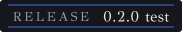
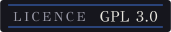
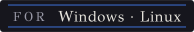
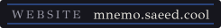
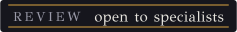
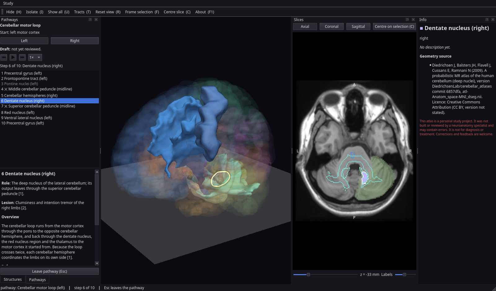
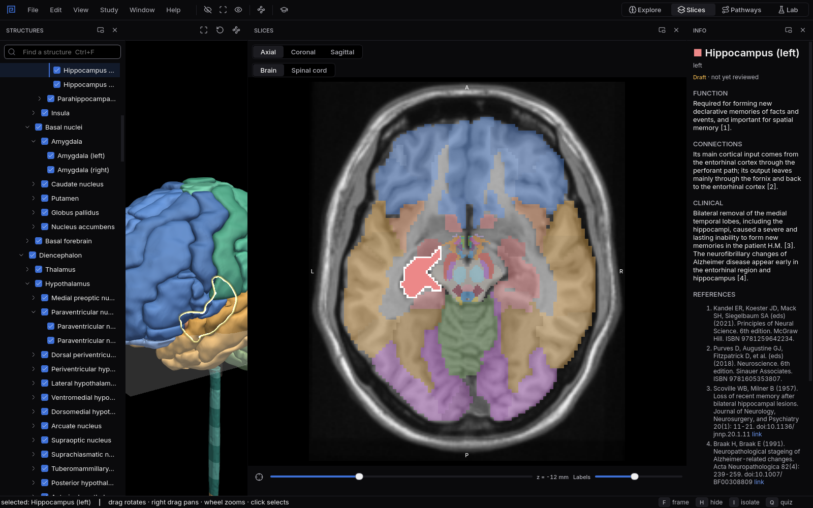
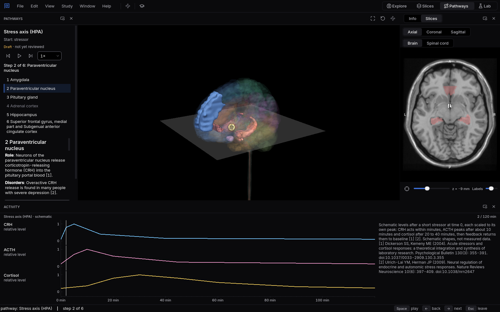
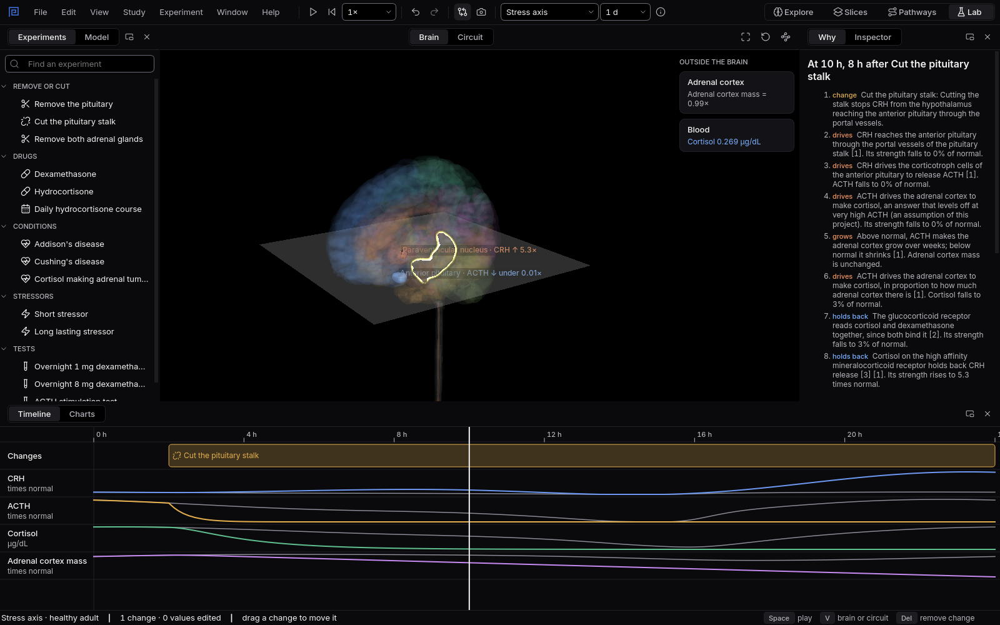
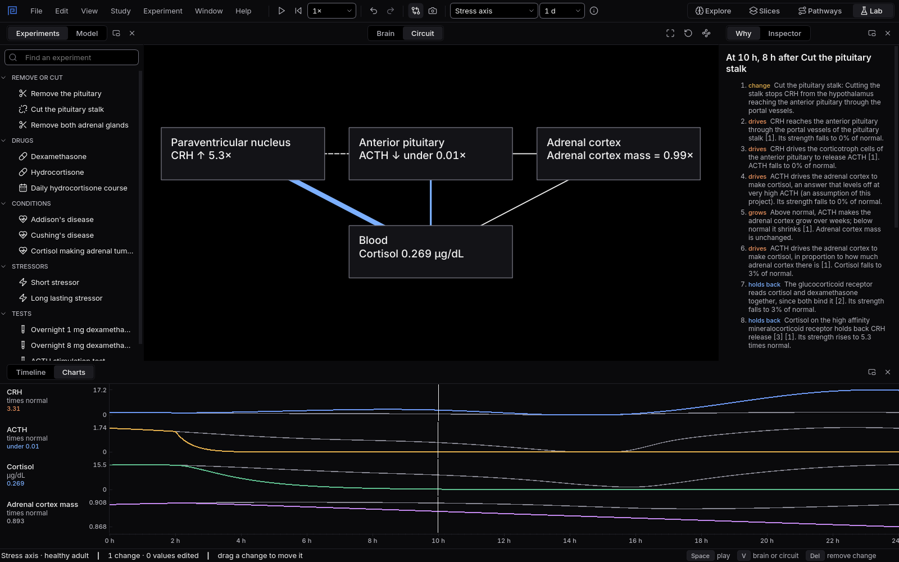

<p align="center">
  <picture>
    <source media="(prefers-color-scheme: dark)" srcset="brand/logo-seal-dark.svg">
    
  </picture>
</p>

<p align="center"><b>Mnemosyn</b> is a free 3D atlas of the human brain and spinal cord, with a lab<br>
for the body's control systems. Made for students; every shape and sentence cites its source.</p>

<p align="center">
  <a href="https://github.com/anatuphoria/mnemosyn/releases"></a>
  <a href="LICENSE"></a>
  <a href="https://mnemo.saeed.cool/download/"></a>
  <a href="https://mnemo.saeed.cool/"></a>
  <a href="https://mnemo.saeed.cool/review/"></a>
</p>

<p align="center">
  <a href="https://mnemo.saeed.cool/download/">Download</a> ·
  <a href="https://mnemo.saeed.cool/guide/">Using the app</a> ·
  <a href="https://mnemo.saeed.cool/atlas/structures/">The atlas</a> ·
  <a href="https://mnemo.saeed.cool/review/">Review</a> ·
  <a href="https://mnemo.saeed.cool/decisions/">Decisions</a>
</p>

<p align="center"></p>

## What it is

Mnemosyn is a desktop atlas for learning neuroanatomy and the physiology built on it. You turn the
brain and spinal cord in 3D, read them in slices like the plates of a printed atlas, follow
pathways station by station, test yourself with spaced repetition, and in the Lab change a body
system and watch what follows over minutes to weeks. Every structure comes from an open, published
atlas, every description and every number in the Lab cites its reference, and every choice behind
the project is recorded in its [decision log](https://mnemo.saeed.cool/decisions/).

The name joins Mnemosyne (ΜΝΗΜΟΣΥΝΗ), the Greek goddess of memory, with the synapse, where memories
are stored. Its mark is one turn of the Greek key, the endless line that runs through the brand.

## What you can do

### Explore in 3D

The whole central nervous system in one scene: cortex, deep nuclei, hypothalamus, brainstem,
cerebellum and spinal cord, 224 structures in 45 groups. Hide, isolate, search and frame any of
them; show the 43 white matter tracts all at once or one by one; look through the shells of the
brainstem and cord to the nuclei inside. Every structure opens its description with numbered
references, its side and the atlas it comes from.

### Read slices like atlas plates

<p align="center"></p>

Axial, coronal and sagittal sections show coloured labels over an MRI template (Colin 27 for the
brain, PAM50 for the spinal cord in local builds), in neurological convention with the orientation
letters on the edges. The slice plane moves through the 3D view too; hovering names what is under
the pointer, a click selects it, and one key centres the slice on the selection.

### Follow pathways and circuits

<p align="center"></p>

Eighteen routes, followed station by station: eight sensory and motor pathways (visual, auditory,
the Papez circuit, voluntary movement, touch and position, pain and temperature, and the basal
ganglia and cerebellar loops) and ten behaviour circuits (dopamine, serotonin, noradrenaline,
acetylcholine, fear, the stress axis, the body clock, hunger, memory, and decision and self control).
Each station lights up in 3D and in the slice, with its role and what a lesion there causes, or for
behaviour circuits the disorders and drugs that act there. Play steps through a route on its own;
three of them play a schematic hormone timeline beside it.

### Run experiments in the Lab

<p align="center"></p>

The Lab runs a computed model of a body system, starting with the stress axis (hypothalamus,
pituitary, adrenal cortex and cortisol) after Karin and colleagues (2020). Drag a change onto the
timeline: remove the pituitary or the adrenal glands, cut the pituitary stalk, give dexamethasone
or hydrocortisone once or every day, switch on Addison's disease, Cushing's disease or an adrenal
tumour, add a short or a long stressor, or run the overnight 1 mg and 8 mg dexamethasone tests and
the ACTH stimulation test. The model computes every value in real units over hours to weeks, next
to the untouched normal day.

<p align="center"></p>

The brain colours each part by how far it is from normal, or the centre turns into a live circuit
whose arrows thicken and thin with each signal. **Why** explains the difference at the playhead as a
numbered chain of causes, each marked with what it does and with its sources. Experts can open every
one of the model's 25 parameters with its normal value, range and source. An experiment saves as a
small `.mnemolab` text file you can send to someone; it holds only the experiment.

### Quiz yourself

*Name it* highlights a structure and asks for its name, typed (synonyms, abbreviations and small
typos count) or picked from four. *Find it* names one and you click it in 3D or in a slice.
*Flashcards* show reviewed descriptions. Choose single structures, groups or tracts, the whole atlas
or one part of it. Reviews are scheduled with FSRS, the spaced repetition method Anki uses, and your
progress stays on your computer.

### One interface for all of it

Four workspaces (Explore, Slices, Pathways and the Lab) arrange the window for each task, and every
panel can be moved, floated or closed. The interface follows one design system: a black dark theme
with checked contrast, the Inter typeface and Lucide icons bundled so it looks the same on every
computer, and layouts that fit windows from 850 px wide to large screens. Every action has a key;
the [guide](https://mnemo.saeed.cool/guide/) lists them all.

## Get it

Download the test version for Windows or Linux from the [Download
page](https://mnemo.saeed.cool/download/). It carries the shareable atlas; sources whose authors
have not yet allowed sharing stay in local builds.

To build from source:

```bash
python -m venv .venv
.venv/bin/pip install -e ".[desktop,atlas-build,dev]"
.venv/bin/python -m tools.build_atlas    # downloads the open atlases and builds atlases/cns
.venv/bin/python -m tools.build_atlas --local    # also adds sources not yet allowed to be shared
.venv/bin/mnemosyn                       # desktop app
```

How to make your own packages, including a full local one for your own machines, is in
`docs/packaging.md`. A terminal viewer, [Mnemosyn TUI](https://github.com/anatuphoria/mnemosyn-tui),
reads the same atlas packages.

## The atlas data

Every structure, tract and template comes from a published atlas with its citation and licence:
16 sources, 7 of them in the download and 9 kept to local builds until their authors allow sharing.
The full list, with what each source provides, is on the [Data sources
page](https://mnemo.saeed.cool/atlas/sources/); how the atlas is built and checked is on [Building
the atlas](https://mnemo.saeed.cool/building-the-atlas/).

| Data | Source | Licence |
|---|---|---|
| Brain geometry, 166 structures | AAL3: Rolls ET, Huang CC, Lin CP, Feng J, Joliot M (2020), NeuroImage 206: 116189, doi:10.1016/j.neuroimage.2019.116189 | GNU General Public License (text in `atlas_src/LICENSES/GPL-3.0.txt`) |
| Hypothalamic region, 21 structures | Neudorfer C, Germann J, Elias GJB, Gramer R, Boutet A, Lozano AM (2020), Scientific Data 7: 305, doi:10.1038/s41597-020-00644-6 | CC BY 4.0 (notice in `atlas_src/LICENSES/CC-BY-4.0.txt`) |
| Tracts, 41 | HCP-1065 tractography atlas: Yeh FC et al. (2018), NeuroImage 178: 57-68, doi:10.1016/j.neuroimage.2018.05.027 | CC BY-SA 4.0 (notice in `atlas_src/LICENSES/CC-BY-SA-4.0.txt`) |
| Pituitary gland (local builds only) | Tang K (2024), pituitary mask on the MNI ICBM152 2009a template, github.com/kvttt/Pituitary_Segmentation | No licence stated; used only in local builds until the author allows sharing |
| Pineal gland (local builds only) | Razavi F, Raminfard S, Kalantar Hormozi H, Sisakhti M, Batouli SAH (2021), Frontiers in Neuroinformatics 15: 554229, doi:10.3389/fninf.2021.554229 | No licence stated for the atlas files; used only in local builds until the authors allow sharing |
| Brainstem arousal nuclei, 6 structures | Harvard Ascending Arousal Network Atlas 2.0: Edlow BL, Kinney HC (2023), Dryad, doi:10.5061/dryad.zw3r228d2 (downloaded by hand) | CC0 1.0 (notice in `atlas_src/LICENSES/CC0-1.0.txt`) |
| Dentate and interposed nuclei | Diedrichsen J, Balsters JH, Flavell J, Cussans E, Ramnani N (2009), NeuroImage 46: 39-46, doi:10.1016/j.neuroimage.2009.01.045; nuclei from Diedrichsen J, Maderwald S, Küper M et al. (2011), NeuroImage 54: 1786-1794, doi:10.1016/j.neuroimage.2010.10.035 | CC BY (notice in `atlas_src/LICENSES/CC-BY-Diedrichsen.txt`) |
| Cochlear nuclei, superior olivary complex, inferior colliculus | Sitek KR, Gulban OF et al. (2019), eLife 8: e48932, doi:10.7554/eLife.48932 | BSD 3-Clause (text in `atlas_src/LICENSES/BSD-3-Clause-Sitek.txt`) |
| Ten brainstem nuclei (local builds only) | Brainstem Navigator v1.0, Bianciardi lab, doi:10.25790/bml0cm.96 (downloaded by hand) | Non-commercial, no sharing outside the organisation; used only in local builds until the authors allow sharing |
| Midbrain, pons and medulla bodies (local builds only) | Iglesias JE, Van Leemput K, Bhatt P, Casillas C, Dutt S, Schuff N, Truran-Sacrey D, Boxer A, Fischl B (2015), NeuroImage 113: 184-195, doi:10.1016/j.neuroimage.2015.02.065; MNI ICBM 2009c version from the FreeSurfer wiki | No licence stated; used only in local builds until the authors allow sharing |
| Spinal cord: surface, 30 segments, grey matter, 30 tracts (local builds only) | PAM50: De Leener B, Fonov VS, Collins DL, Callot V, Stikov N, Cohen-Adad J (2018), NeuroImage 165: 170-179, doi:10.1016/j.neuroimage.2017.10.041 | No licence stated; used only in local builds until the authors allow sharing |
| MRI template for slices | Colin 27 Average Brain (1998): Holmes CJ, Hoge R, Collins L, Woods R, Toga AW, Evans AC (1998), J Comput Assist Tomogr 22(2): 324-333, doi:10.1097/00004728-199803000-00032 | Permissive notice (text in `atlas_src/LICENSES/Colin27.txt`) |
| Descriptions | Written for this project; every claim cites a reference | CC BY 4.0 |
| Interface typeface | Inter 4.1, Rasmus Andersson and the Inter Project Authors, rsms.me/inter | SIL Open Font License 1.1 (text in `cns_desktop/resources/fonts/OFL.txt`) |
| Interface icons | Lucide 0.460, Lucide Contributors, lucide.dev | ISC License (text in `cns_desktop/resources/icons/LICENSE`) |
| Code | This repository | GNU General Public License v3.0 or later (`LICENSE`) |

## Review and disclaimer

> **Disclaimer.** This atlas is a personal study project. It was not built or reviewed by a
> neuroanatomy specialist and may contain errors. It is not for diagnosis or treatment.
> Corrections and feedback are welcome.

Specialists can help: download the review booklet and ask for access to the answer form on the
[Review page](https://mnemo.saeed.cool/review/). Questions and corrections are also welcome in
[GitHub Discussions](https://github.com/anatuphoria/mnemosyn/discussions).

## Contributing and licence

```bash
.venv/bin/python -m pytest            # fast suite, including lint (ruff) at zero findings
.venv/bin/python -m pytest -m slow    # with the real atlas built: speed limits and builds
pip install "mkdocs>=1.6,<2" "mkdocs-material>=9.5,<10"
python -m tools.build_site && mkdocs serve   # preview the website
.venv/bin/pip install -e ".[brand]" && .venv/bin/python -m tools.brand   # redraw logos and badges
```

```
cns_atlas/          atlas package loader (no Qt): model, meshes, knowledge, volume, atlas
cns_lab/            the Lab's engine (numpy only): expressions, solver, experiments, checks, Why
cns_study/          quizzes: items, answers, choices, sessions, FSRS progress
cns_desktop/        desktop app: main window, workspaces, views/, lab/, resources/
cns_desktop/design/ the design system: tokens, font, icons, stylesheet, shared widgets, charts
tools/build_atlas/  atlas build tool: recipe, hierarchy, validate, fetch, labels, meshing, models
tools/package/      Windows installer and Linux AppImage packaging
tools/brand/        draws the logos, icon and badges from the fonts in brand/fonts/
tools/build_site.py writes the website pages; site/ holds their sources and styles
atlas_src/          committed atlas sources: recipe, structures, ids.lock, knowledge, models
brand/              logos, icon, badges, screenshots and the logo font with its licence
docs/               design documents (specs/), the decision log and packaging instructions
tests/
```

The code is under the GNU General Public License v3.0 or later (`LICENSE`); the descriptions are CC
BY 4.0; the GFS Didot font used for the logos is under the SIL Open Font Licence (OFL, in
`brand/fonts/`), as is the Inter typeface of the interface. The design of every
part is in the [design documents](https://mnemo.saeed.cool/design/), and the limits the app is held
to are on the [Performance page](https://mnemo.saeed.cool/performance/).
