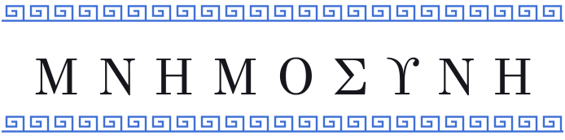

<p align="center">
  <picture>
    <source media="(prefers-color-scheme: dark)" srcset="brand/wordmark-dark.svg">
    
  </picture>
</p>

<p align="center"><b>Mnemosyn</b>, a free 3D atlas of the human central nervous system for students.</p>

<p align="center">
  <a href="https://github.com/anatuphoria/mnemosyn/releases"></a>
  <a href="LICENSE"></a>
  <a href="https://mnemo.saeed.cool/download/"></a>
  <a href="https://mnemo.saeed.cool/"></a>
  <a href="https://mnemo.saeed.cool/review/"></a>
</p>

<p align="center">
  <a href="https://mnemo.saeed.cool/download/">Download</a> ·
  <a href="https://mnemo.saeed.cool/guide/">Using the app</a> ·
  <a href="https://mnemo.saeed.cool/atlas/structures/">The atlas</a> ·
  <a href="https://mnemo.saeed.cool/review/">Review</a> ·
  <a href="https://mnemo.saeed.cool/decisions/">Decisions</a>
</p>

<p align="center"></p>

<p align="center"></p>

## What it is

Turn the brain and spinal cord in 3D, cut through them in axial, coronal and sagittal slices, follow
sensory, motor and behaviour pathways station by station with what a lesion there causes, and test
yourself with spaced-repetition quizzes. Every shape comes from open, cited research data, and every
choice behind the project is recorded in its [decision log](https://mnemo.saeed.cool/decisions/).

- **Explore in 3D:** hide, isolate, search and frame any structure; tracts and a see-through cord.
- **Slices like atlas plates:** labels over an MRI template, linked to the 3D view, with zoom and
  pan.
- **Pathways and circuits:** visual, auditory, motor, touch, pain, cerebellar and basal ganglia
  routes, and ten behaviour circuits with schematic hormone timelines.
- **Quiz yourself:** name it, find it and flashcards, scheduled with FSRS.

The name joins Mnemosyne (ΜΝΗΜΟΣΥΝΗ), the Greek goddess of memory, with the synapse, where memories
are stored. A terminal viewer, [Mnemosyn TUI](https://github.com/anatuphoria/mnemosyn-tui), reads
the same atlas packages.

<p align="center"></p>

## Get it

Download the test version for Windows or Linux from the [Download
page](https://mnemo.saeed.cool/download/). It carries the shareable atlas; sources whose authors
have not yet allowed sharing stay in local builds.

To build from source:

```bash
python -m venv .venv
.venv/bin/pip install -e ".[desktop,atlas-build,dev]"
.venv/bin/python -m tools.build_atlas    # downloads the open atlases and builds atlases/cns
.venv/bin/python -m tools.build_atlas --local    # also adds sources not yet allowed to be shared
.venv/bin/mnemosyn                       # desktop app
```

How to make your own packages, including a full local one for your own machines, is in
`docs/packaging.md`.

<p align="center"></p>

## The atlas data

Every structure, tract and template comes from a published atlas with its citation and licence. The
full list, with what each source provides, is on the [Data sources
page](https://mnemo.saeed.cool/atlas/sources/); how the atlas is built and checked is on [Building
the atlas](https://mnemo.saeed.cool/building-the-atlas/).

| Data | Source | Licence |
|---|---|---|
| Brain geometry, 166 structures | AAL3: Rolls ET, Huang CC, Lin CP, Feng J, Joliot M (2020), NeuroImage 206: 116189, doi:10.1016/j.neuroimage.2019.116189 | GNU General Public License (text in `atlas_src/LICENSES/GPL-3.0.txt`) |
| Hypothalamic region, 21 structures | Neudorfer C, Germann J, Elias GJB, Gramer R, Boutet A, Lozano AM (2020), Scientific Data 7: 305, doi:10.1038/s41597-020-00644-6 | CC BY 4.0 (notice in `atlas_src/LICENSES/CC-BY-4.0.txt`) |
| Tracts, 41 | HCP-1065 tractography atlas: Yeh FC et al. (2018), NeuroImage 178: 57-68, doi:10.1016/j.neuroimage.2018.05.027 | CC BY-SA 4.0 (notice in `atlas_src/LICENSES/CC-BY-SA-4.0.txt`) |
| Pituitary gland (local builds only) | Tang K (2024), pituitary mask on the MNI ICBM152 2009a template, github.com/kvttt/Pituitary_Segmentation | No licence stated; used only in local builds until the author allows sharing |
| Pineal gland (local builds only) | Razavi F, Raminfard S, Kalantar Hormozi H, Sisakhti M, Batouli SAH (2021), Frontiers in Neuroinformatics 15: 554229, doi:10.3389/fninf.2021.554229 | No licence stated for the atlas files; used only in local builds until the authors allow sharing |
| Brainstem arousal nuclei, 6 structures | Harvard Ascending Arousal Network Atlas 2.0: Edlow BL, Kinney HC (2023), Dryad, doi:10.5061/dryad.zw3r228d2 (downloaded by hand) | CC0 1.0 (notice in `atlas_src/LICENSES/CC0-1.0.txt`) |
| Dentate and interposed nuclei | Diedrichsen J, Balsters JH, Flavell J, Cussans E, Ramnani N (2009), NeuroImage 46: 39-46, doi:10.1016/j.neuroimage.2009.01.045; nuclei from Diedrichsen J, Maderwald S, Küper M et al. (2011), NeuroImage 54: 1786-1794, doi:10.1016/j.neuroimage.2010.10.035 | CC BY (notice in `atlas_src/LICENSES/CC-BY-Diedrichsen.txt`) |
| Cochlear nuclei, superior olivary complex, inferior colliculus | Sitek KR, Gulban OF et al. (2019), eLife 8: e48932, doi:10.7554/eLife.48932 | BSD 3-Clause (text in `atlas_src/LICENSES/BSD-3-Clause-Sitek.txt`) |
| Ten brainstem nuclei (local builds only) | Brainstem Navigator v1.0, Bianciardi lab, doi:10.25790/bml0cm.96 (downloaded by hand) | Non-commercial, no sharing outside the organisation; used only in local builds until the authors allow sharing |
| Midbrain, pons and medulla bodies (local builds only) | Iglesias JE, Van Leemput K, Bhatt P, Casillas C, Dutt S, Schuff N, Truran-Sacrey D, Boxer A, Fischl B (2015), NeuroImage 113: 184-195, doi:10.1016/j.neuroimage.2015.02.065; MNI ICBM 2009c version from the FreeSurfer wiki | No licence stated; used only in local builds until the authors allow sharing |
| Spinal cord: surface, 30 segments, grey matter, 30 tracts (local builds only) | PAM50: De Leener B, Fonov VS, Collins DL, Callot V, Stikov N, Cohen-Adad J (2018), NeuroImage 165: 170-179, doi:10.1016/j.neuroimage.2017.10.041 | No licence stated; used only in local builds until the authors allow sharing |
| MRI template for slices | Colin 27 Average Brain (1998): Holmes CJ, Hoge R, Collins L, Woods R, Toga AW, Evans AC (1998), J Comput Assist Tomogr 22(2): 324-333, doi:10.1097/00004728-199803000-00032 | Permissive notice (text in `atlas_src/LICENSES/Colin27.txt`) |
| Descriptions | Written for this project; every claim cites a reference | CC BY 4.0 |
| Code | This repository | GNU General Public License v3.0 or later (`LICENSE`) |

<p align="center"></p>

## Review and disclaimer

> **Disclaimer.** This atlas is a personal study project. It was not built or reviewed by a
> neuroanatomy specialist and may contain errors. It is not for diagnosis or treatment.
> Corrections and feedback are welcome.

Specialists can help: download the review booklet and ask for access to the answer form on the
[Review page](https://mnemo.saeed.cool/review/). Questions and corrections are also welcome in
[GitHub Discussions](https://github.com/anatuphoria/mnemosyn/discussions).

<p align="center"></p>

## Contributing and licence

```bash
.venv/bin/python -m pytest            # fast suite, including lint (ruff) at zero findings
.venv/bin/python -m pytest -m slow    # with the real atlas built: speed limits and builds
pip install "mkdocs>=1.6,<2" "mkdocs-material>=9.5,<10"
python -m tools.build_site && mkdocs serve   # preview the website
.venv/bin/pip install -e ".[brand]" && .venv/bin/python -m tools.brand   # redraw logo and badges
```

```
cns_atlas/          atlas package loader (no Qt): model, meshes, knowledge, volume, atlas
cns_desktop/        desktop app: app, main_window, state, views/, resources/ (icon, wordmark)
cns_study/          quizzes: items, answers, choices, sessions, FSRS progress
tools/build_atlas/  atlas build tool: recipe, hierarchy, validate, fetch, labels, meshing,
                    compare, writer
tools/package/      Windows installer and Linux AppImage packaging
tools/brand/        draws the logo, icons and badges from the fonts in brand/fonts/
tools/build_site.py writes the website pages; site/ holds their sources and styles
atlas_src/          committed atlas sources: recipe, structures, ids.lock, knowledge, LICENSES
brand/              logo, badges, dividers, screenshot and the two fonts with their licences
docs/               design documents (specs/), the decision log and packaging instructions
tests/
```

The code is under the GNU General Public License v3.0 or later (`LICENSE`); the descriptions are CC
BY 4.0; the GFS Didot and Noto Sans Bamum fonts used for the logo are under the SIL Open Font
Licence (OFL, in `brand/fonts/`). The design of every part is in the
[design documents](https://mnemo.saeed.cool/design/), and the limits the app is held to are on the
[Performance page](https://mnemo.saeed.cool/performance/).
