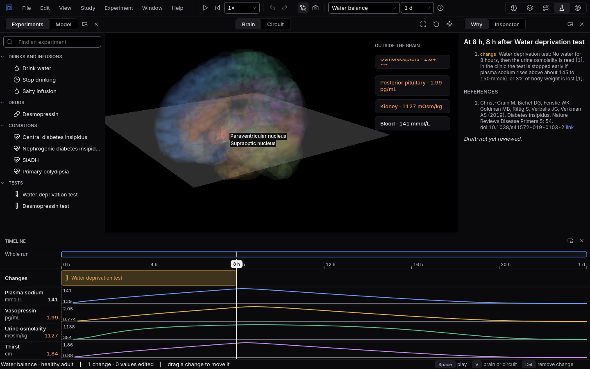

# A night without water

Eight hours without water is one of the oldest tests in endocrinology. Clinics often start it the
evening before; here it runs from 08:00 to 16:00. What it shows depends on two things working: the
brain releasing vasopressin, and the kidneys answering it.
{ .lede }

### The question

A healthy person and a person with central diabetes insipidus both go eight hours without water.
At the end their urine is measured.

**Predict before you open it.** What happens to plasma sodium, vasopressin and the urine in each?

## Open it

1. Download [healthy.mnemolab](files/a-night-without-water/healthy.mnemolab) and
   [central-di.mnemolab](files/a-night-without-water/central-di.mnemolab).
2. In Mnemosyn, switch to the **Lab** and choose **File, Open** (`Ctrl+O`).

## What to look at

{ .shot }

A healthy body after eight hours without water: sodium edges up, vasopressin rises and the urine is strongly concentrated.

1. Follow **Plasma sodium**, **Vasopressin** and **Urine osmolality** through the eight hours.
2. Select the **Water deprivation test** on the timeline and read the result in the **Inspector**.
3. Open the second file and compare the same three lanes.

??? note "What you will see, and why"
    In the **healthy** body, sodium creeps up as water is lost, the osmoreceptors notice, and the
    supraoptic and paraventricular nuclei release more vasopressin. The kidneys answer by keeping
    water, and after eight hours the urine is above 800 mOsm/kg: the test is normal.

    With **central diabetes insipidus** the brain releases far too little vasopressin: it stays
    below its normal level instead of rising, so the kidneys are never told to keep water. The
    urine stays dilute throughout, and the test points to diabetes insipidus. Thirst and sodium
    rise instead, which is why people with this condition drink so
    much. Whether the cause is in the brain or the kidneys is the next question:
    [Central or nephrogenic?](central-or-nephrogenic.md)

    Source: Christ-Crain M and colleagues (2019), Diabetes insipidus, Nature Reviews Disease
    Primers, [doi:10.1038/s41572-019-0103-2](https://doi.org/10.1038/s41572-019-0103-2).
