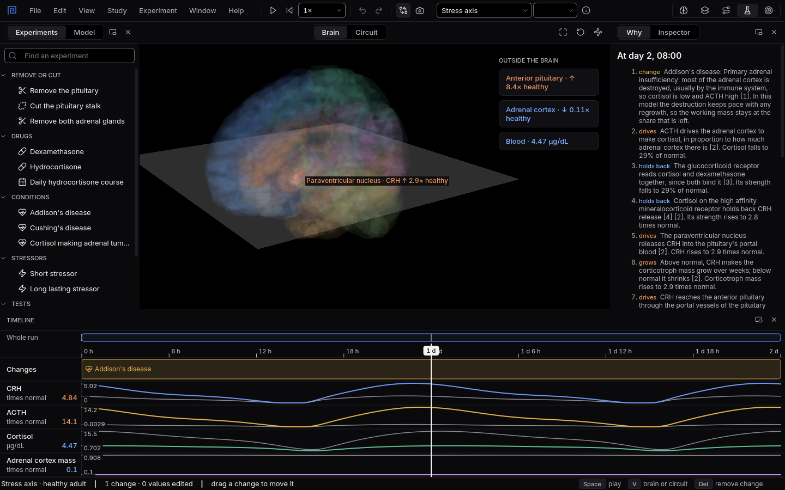

# Addison's disease

When most of the adrenal cortex is destroyed, cortisol falls. The interesting part is what the rest
of the loop does about it.
{ .lede }

### The question

In Addison's disease the immune system destroys most of the adrenal cortex. The hypothalamus and
pituitary are untouched.

**Predict before you open it.** What happens to cortisol, and to ACTH, by the next morning?

## Open it

1. Download [addison.mnemolab](files/addisons-disease/addison.mnemolab).
2. In Mnemosyn, switch to the **Lab** and choose **File, Open** (`Ctrl+O`).

## What to look at

{ .shot }

Addison's disease on the second morning: cortisol far below its normal day, ACTH many times above it.

1. Compare **Cortisol** and **ACTH** with the grey normal day behind them.
2. Move the playhead to the second morning and read the **Why** panel.
3. Press `V` to see the loop as a circuit.

??? note "What you will see, and why"
    By the second morning cortisol is less than half of its normal level, and ACTH is more than
    five times its normal level.

    The loop explains both. Cortisol normally holds the hypothalamus and pituitary back. With
    little cortisol left, nothing holds them back, so CRH and ACTH climb. The remaining adrenal
    cortex cannot answer however much ACTH arrives. High ACTH is why Addison's disease is called
    primary adrenal insufficiency: the fault is in the gland, and the brain is shouting at it. It
    is also behind the darker skin many patients have, because the molecule ACTH is cut from also
    makes melanocyte stimulating hormone.

    Source: Bornstein SR and colleagues (2016), Diagnosis and treatment of primary adrenal
    insufficiency: an Endocrine Society clinical practice guideline.
