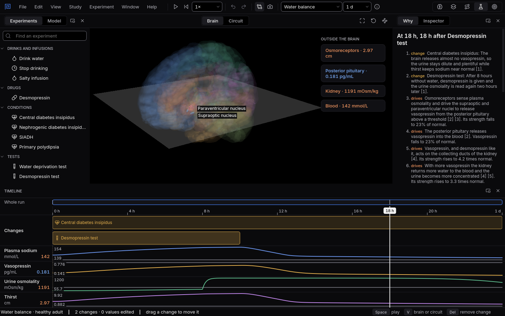

# Central or nephrogenic?

Two people make large amounts of dilute urine. One brain makes no vasopressin; in the other, the
kidneys cannot answer it. One test tells them apart.
{ .lede }

### The question

Both people go eight hours without water, and their urine stays dilute. Then each is given
desmopressin, the synthetic form of vasopressin, and the urine is read again two hours later.
How will the two results differ?

**Predict before you open it.** Which person's urine will rise, and by how much?

## Open it

1. Download [central.mnemolab](files/central-or-nephrogenic/central.mnemolab) and
   [nephrogenic.mnemolab](files/central-or-nephrogenic/nephrogenic.mnemolab).
2. In Mnemosyn, switch to the **Lab** and choose **File, Open** (`Ctrl+O`). Open one, then the
   other.

## What to look at

{ .shot }

Central diabetes insipidus: the urine stays dilute through the night without water, then jumps when desmopressin is given.

1. Watch the **Urine osmolality** lane during the eight hours without water, then after the
   desmopressin.
2. Select the **Desmopressin test** on the timeline and read its result in the **Inspector**.
3. Compare the **Vasopressin** lane in the two files.

??? note "What you will see, and why"
    In both files the urine stays below 300 mOsm/kg after eight hours without water: neither body
    can concentrate it, so both have diabetes insipidus.

    After desmopressin the two part ways. In **central** diabetes insipidus the urine rises by more
    than half, and the Inspector reads the test as pointing to a central cause: the brain was
    not making vasopressin, but the kidneys answer it as soon as it is given. In **nephrogenic**
    diabetes insipidus the urine hardly moves: the kidneys cannot answer vasopressin, so giving
    more changes nothing. The Vasopressin lane shows the other half of the story: in the
    nephrogenic file the brain already makes plenty.

    Source: Christ-Crain M and colleagues (2019), Diabetes insipidus, Nature Reviews Disease
    Primers, [doi:10.1038/s41572-019-0103-2](https://doi.org/10.1038/s41572-019-0103-2).
