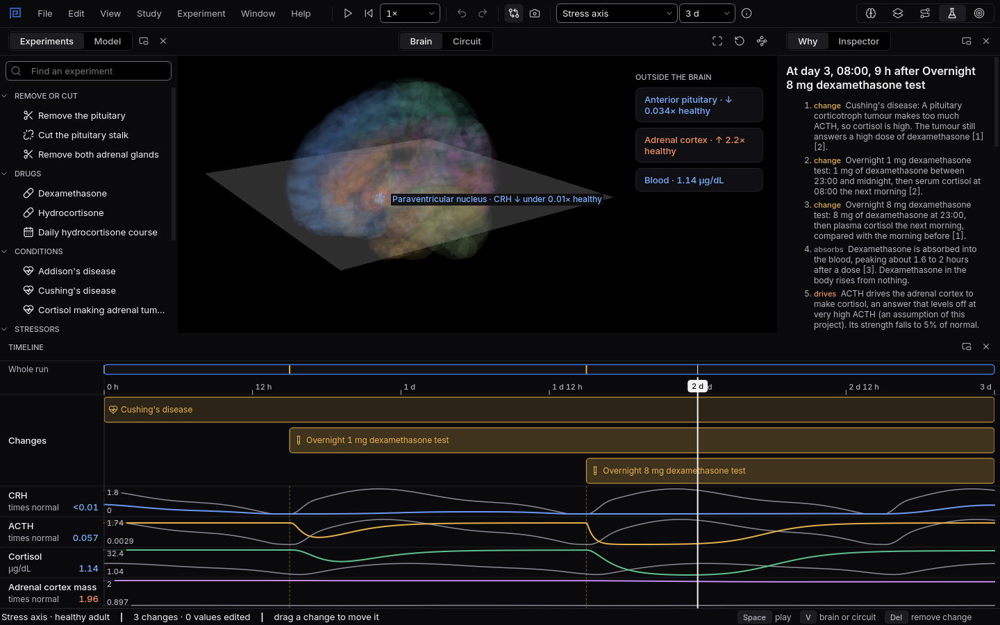

# The dexamethasone tests

Dexamethasone is a steroid the cortisol feedback loop cannot tell apart from cortisol. Two doses of
it, given at night, tell three bodies apart.
{ .lede }

### The question

Three people take the overnight 1 mg dexamethasone test, then the overnight 8 mg test the night
after. One is healthy, one has Cushing's disease (a pituitary tumour making ACTH), and one has an
adrenal tumour making cortisol on its own.

**Predict before you open it.** Whose morning cortisol falls after 1 mg? After 8 mg?

## Open it

1. Download [healthy.mnemolab](files/dexamethasone-tests/healthy.mnemolab),
   [cushing-disease.mnemolab](files/dexamethasone-tests/cushing-disease.mnemolab) and
   [adrenal-tumour.mnemolab](files/dexamethasone-tests/adrenal-tumour.mnemolab).
2. In Mnemosyn, switch to the **Lab** and choose **File, Open** (`Ctrl+O`).

## What to look at

{ .shot }

Cushing's disease: cortisol stays high after 1 mg of dexamethasone but falls after 8 mg.

1. Select each test on the timeline and read its result in the **Inspector**.
2. Watch **ACTH** and **Cortisol** on the mornings after each dose.
3. Compare the three files.

??? note "What you will see, and why"
    In the **healthy** body, 1 mg is enough: the pituitary reads dexamethasone as cortisol, stops
    making ACTH, and morning cortisol falls below 1.8 µg/dL (50 nmol/L). The 8 mg test suppresses
    it too.

    In **Cushing's disease** the pituitary tumour ignores the small dose, so cortisol is not
    suppressed after 1 mg, which points to Cushing's syndrome. But the tumour still answers a
    large dose: after 8 mg cortisol falls to less than half of the morning before, which points to
    a pituitary cause.

    With an **adrenal tumour**, cortisol is made without ACTH, so neither dose can switch it off.
    ACTH is already held down by the tumour's own cortisol, and there is nothing left for
    dexamethasone to suppress.

    Sources: Nieman LK and colleagues (2008), The diagnosis of Cushing's syndrome: an Endocrine
    Society clinical practice guideline,
    [doi:10.1210/jc.2008-0125](https://doi.org/10.1210/jc.2008-0125); Tyrrell JB and colleagues
    (1986), An overnight high dose dexamethasone suppression test for rapid differential diagnosis
    of Cushing's syndrome, [doi:10.7326/0003-4819-104-2-180](https://doi.org/10.7326/0003-4819-104-2-180).
