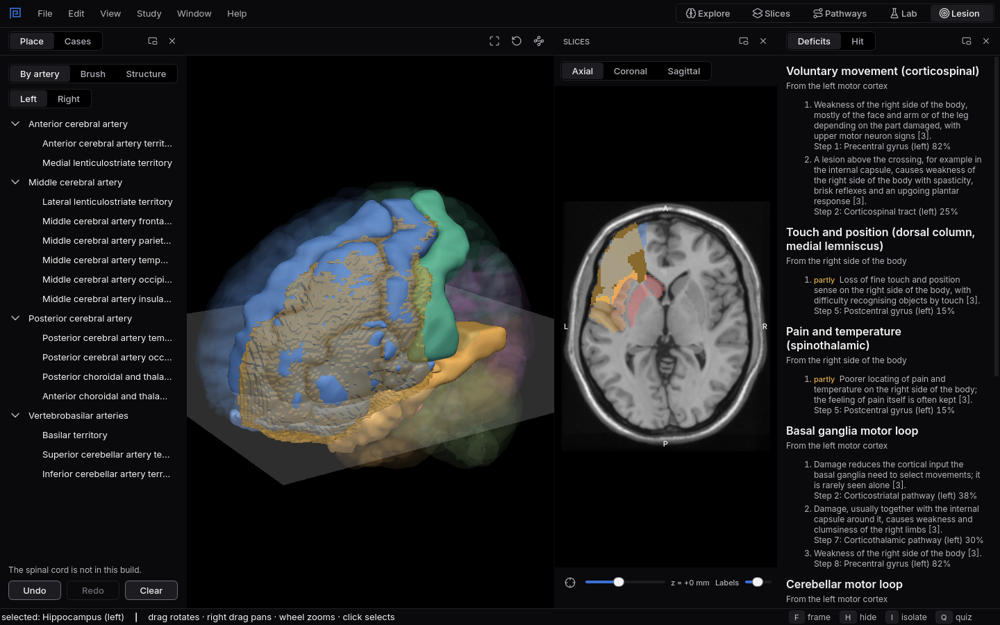

# One artery, many structures

A stroke is shaped by an artery, not by the boundaries anatomists draw. One blocked branch can take
out structures with very different jobs, and that is why the signs come together.
{ .lede }

### The question

The frontal branches of the left middle cerebral artery are blocked.

**Predict before you open it.** Which parts of the left frontal lobe lose their blood supply, and
which signs would you expect together?

## Open it

1. In Mnemosyn, switch to the **Lesion** workspace (`Ctrl+5`).
2. In **Place**, choose **By artery**, then **Left**.
3. Under **Middle cerebral artery**, choose **Middle cerebral artery frontal territory**.

## What to look at

{ .shot }

The lesion drawn in gold over the left frontal lobe, with the routes it breaks listed under Deficits.

1. Open the **Hit** tab and read which structures are inside the lesion, and how much of each.
2. Open **Deficits** and read the first routes it breaks.
3. Turn the 3D view to see how the lesion follows the artery across gyri.

??? note "What you will see, and why"
    The territory takes most of the **precentral gyrus**, where voluntary movement starts, and most
    of the **opercular and triangular parts of the inferior frontal gyrus**, together known as
    Broca's area, which is needed to produce speech.

    These have different jobs but share one artery, so one blockage hits both. On the left side
    that gives the classic pairing of weakness of the right face and arm with difficulty
    producing speech. **Deficits** shows the movement half of it, because the voluntary movement
    route starts in the precentral gyrus.

    Sources: Liu CF and colleagues (2023), Digital 3D brain MRI arterial territories atlas,
    Scientific Data, [doi:10.1038/s41597-022-01923-0](https://doi.org/10.1038/s41597-022-01923-0);
    the structure outlines come from the AAL3 atlas of Rolls and colleagues (2020).
