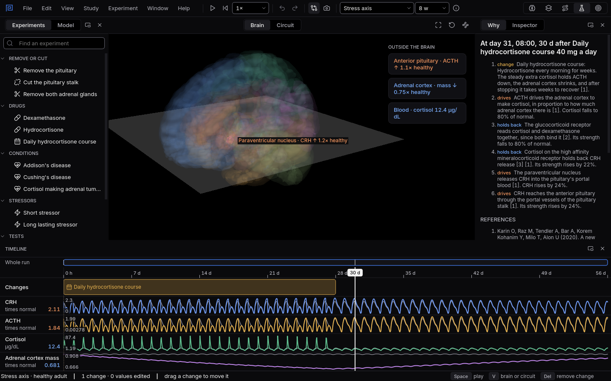

# Stopping a steroid course

Weeks of hydrocortisone quiet the body's own stress axis. Stopping is the dangerous part, and the
reason is in the glands, not the hormones.
{ .lede }

### The question

Someone takes hydrocortisone every morning for four weeks, then stops all at once.

**Predict before you open it.** While the course runs, what happens to ACTH and to the adrenal
cortex? And how much cortisol does the body make in the days after stopping?

## Open it

1. Download [course.mnemolab](files/stopping-a-steroid-course/course.mnemolab).
2. In Mnemosyn, switch to the **Lab** and choose **File, Open** (`Ctrl+O`).

## What to look at

{ .shot }

Two days after four weeks of hydrocortisone: the adrenal cortex has shrunk, and the body's own cortisol is still below normal.

1. Watch **Adrenal cortex mass** over the four weeks of the course.
2. Move the playhead to two days after the course ends and compare **Cortisol** with the normal day.
3. Follow cortisol to the end of the eight weeks.

??? note "What you will see, and why"
    During the course each morning dose holds ACTH down to almost nothing for a few hours. With
    less ACTH each day the adrenal cortex slowly shrinks: by the end of the fourth week it has
    lost at least a fifth of its normal mass.

    When the course stops, the hormone is gone at once but the small gland is not. Two days later
    the body makes less than 85% of its normal cortisol, even with ACTH back above normal,
    because a shrunken cortex cannot answer ACTH fully. Only over the following weeks does the
    gland grow back, and by the end of the eighth week cortisol is within 15% of its normal day.

    This slow part of the loop, the growth and shrinking of the glands, is what the model by Karin
    and colleagues adds to the classic picture, and it is why long steroid courses are tapered
    rather than stopped.

    Source: Karin O and colleagues (2020), A new model for the HPA axis explains dysregulation of
    stress hormones on the timescale of weeks, Molecular Systems Biology,
    [doi:10.15252/msb.20209510](https://doi.org/10.15252/msb.20209510).
