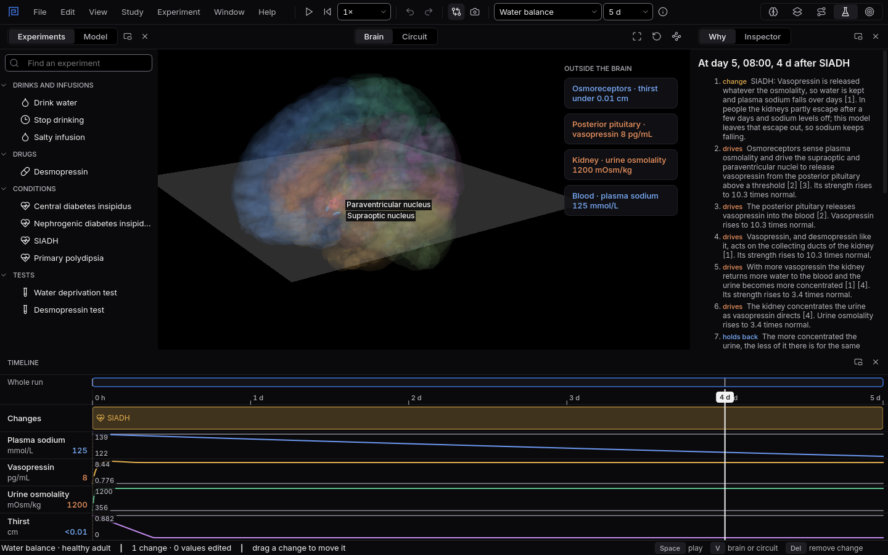

# Too much water

In SIADH the body keeps water it should pass. In primary polydipsia a person drinks far more than
they need. Both mean too much water, but only one of them drags sodium down.
{ .lede }

### The question

One person has SIADH: vasopressin is released whatever the blood needs. Another drinks several
times the usual amount every day, with normal hormones and kidneys.

**Predict before you open it.** Whose sodium falls? And what is the urine like in each?

## Open it

1. Download [siadh.mnemolab](files/too-much-water/siadh.mnemolab) and
   [polydipsia.mnemolab](files/too-much-water/polydipsia.mnemolab).
2. In Mnemosyn, switch to the **Lab** and choose **File, Open** (`Ctrl+O`).

## What to look at

{ .shot }

SIADH on day five: vasopressin stays high, the urine stays concentrated, and plasma sodium keeps falling.

1. In the SIADH file, follow **Plasma sodium** over five days and look at **Urine osmolality**.
2. In the polydipsia file, look at the same two lanes, and at **Vasopressin**.
3. Read the **Why** panel at the end of each run.

??? note "What you will see, and why"
    With **SIADH**, vasopressin tells the kidneys to keep water even though the blood is already
    dilute. The urine stays concentrated, above 300 mOsm/kg, and the water that should have left
    stays in the body. Plasma sodium falls day after day, below 135 mmol/L by the fifth day.

    With **primary polydipsia** the kidneys are healthy and vasopressin is free to fall. The body
    turns the extra water into large amounts of very dilute urine, below 300 mOsm/kg, and plasma
    sodium stays in the normal range. Healthy kidneys can pass a great deal of water; sodium only
    falls when the drinking outpaces even that, or when vasopressin is stuck on, as in SIADH.

    One limit of the model: in people the kidneys partly escape from vasopressin after a few days
    of SIADH and sodium levels off. The model leaves that escape out, so its sodium keeps falling.

    Sources: Hall JE, Hall ME (2021), Guyton and Hall Textbook of Medical Physiology; Christ-Crain M
    and colleagues (2019), Diabetes insipidus, Nature Reviews Disease Primers,
    [doi:10.1038/s41572-019-0103-2](https://doi.org/10.1038/s41572-019-0103-2).
