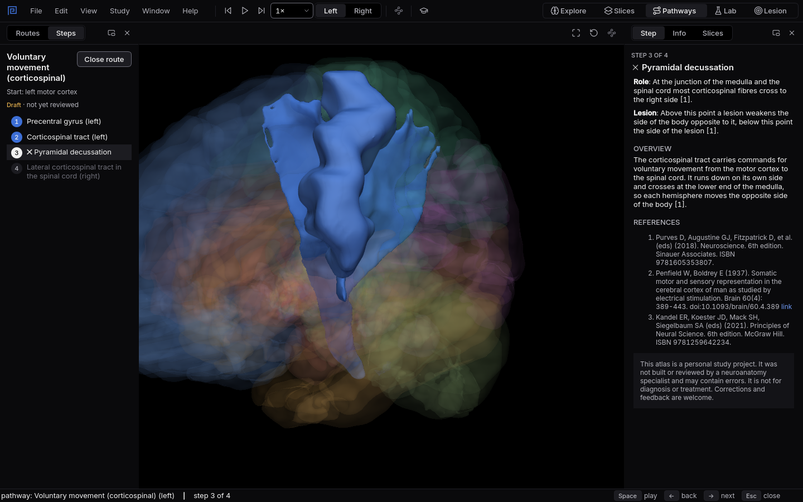

# Which side?

A stroke in the left hemisphere weakens the right side of the body. A cut on the left side of the
spinal cord weakens the left. One crossing explains both.
{ .lede }

### The question

The route for voluntary movement starts in the motor cortex and ends in the spinal cord.

**Predict before you open it.** Where does it cross the midline? And what does that mean for the
side of weakness after a lesion above the crossing, and after one below it?

## Open it

1. In Mnemosyn, switch to the **Pathways** workspace (`Ctrl+3`).
2. In **Routes**, choose **Voluntary movement (corticospinal)** and keep the start side on
   **Left**.
3. Step through it with `Right` and stop at each station.

## What to look at

{ .shot }

Step 3 of 4: the pyramidal decussation, at the junction of the medulla and the spinal cord.

1. Watch where the lit station is in the 3D view at each step, and which side it is on.
2. Read **Lesion** in the **Step** tab at the pyramidal decussation.
3. Open **Pain and temperature** afterwards and compare where it crosses.

??? note "What you will see, and why"
    The route runs from the left precentral gyrus down the left corticospinal tract through the
    brainstem, then crosses at the **pyramidal decussation**, where the medulla meets the spinal
    cord. Every station after the crossing is on the right.

    So a lesion anywhere above the crossing, in the cortex, the internal capsule or the brainstem,
    weakens the opposite side of the body. A lesion below it, in the spinal cord, weakens the same
    side. The pain and temperature route crosses somewhere else entirely, low in the spinal cord
    right where its fibres enter, which is why a lesion of one half of the cord can weaken one leg
    and take away pain on the other.

    The public download has no spinal cord shapes yet, so the last station is named in words, not
    drawn.

    Source: Purves D, Augustine GJ, Fitzpatrick D and colleagues (2018), Neuroscience, 6th
    edition, Sinauer Associates; the route's texts in the app list all its references.
