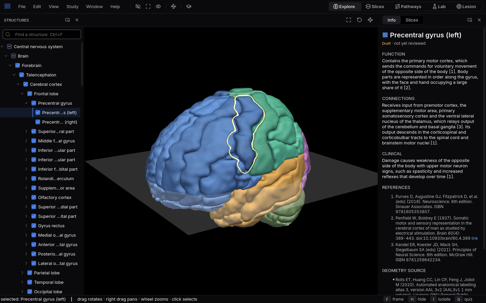
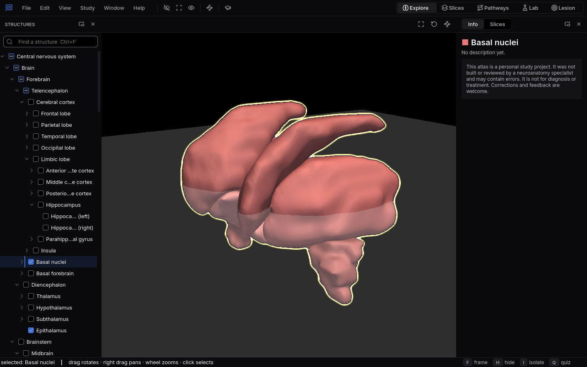

# Explore

The whole brain in 3D: turn it, take it apart, and read what every part does.
{ .lede }

How
Click a part to select it. Drag to turn, scroll to zoom, `F` to frame, `I` to see it alone.

Why here
A figure shows one angle. Here you see a structure from every side, and what lies around it.

What you will see
The selected part outlined in the brain, with its function, connections and clinical notes, all
referenced.

{ .shot }

The left precentral gyrus selected: the primary motor cortex, outlined in the 3D view and described in the Info panel.

## How to use it

**Move around.** Drag with the left button to turn the brain, drag with the right button to pan,
and scroll to zoom. `F` frames the selection, `R` resets the view.

**Select.** Click any part in the 3D view, or pick it in the **Structures** list on the left. Press
`Ctrl+F` to find a structure by name, abbreviation, synonym or atlas label. Selecting a group, such
as the frontal lobe, highlights everything inside it.

**Take it apart.** `H` hides the selection, `I` isolates it so it is all you see, and `U` shows
everything again. The tick boxes in the list do the same for any part: unticking a group hides all
of it, and a half ticked group hides all of it on the first click.

**Read about it.** The **Info** panel describes the selection: its function, its connections and
what damage there causes, with numbered references, and the atlas its shape comes from. Texts
marked **Draft** have not been reviewed yet.

**Tracts.** The white matter tracts, such as the corticospinal tract, the lemnisci and the
cerebellar peduncles, are hidden when the app opens so they do not cover the grey matter. `T` shows
or hides them all; selecting a single tract shows it on its own.

{ .shot }

The basal nuclei isolated with I: the caudate, putamen, globus pallidus and amygdala without the cortex in the way.

## Why use it here

In a book, deep structures are drawn behind the cortex or cut into sections, and you assemble the
shape in your head. Here you can isolate the basal nuclei and turn them, hide one lobe at a time,
or select a structure and watch where its outline sits inside the whole brain. Because every part
is the same object in every workspace, what you learn here carries straight into the slices, the
routes and the Lab.

## What you will see

1. Select the **Hippocampus** and press `I`: it curves along the floor of the lateral ventricle,
   longer and thinner than most figures suggest.
2. Select the **Thalamus**, then hide the **Cerebral cortex** with `H`: the thalamus sits in the
   middle of everything, which is why so many routes pass through it.
3. Press `T` and select the **Corticospinal tract**: follow it from the motor cortex down through
   the internal capsule and the brainstem.

## Shortcuts

| Key | Action |
|---|---|
| `F` | Frame the selection |
| `R` | Reset the view |
| `H` | Hide the selection |
| `I` | Isolate the selection |
| `U` | Show all |
| `T` | Show or hide all tracts |
| `Ctrl+F` | Find a structure |
| `F1` | About Mnemosyn: data sources and licences |
| `Ctrl+1` to `Ctrl+5` | Switch workspace: Explore, Slices, Pathways, Lab, Lesion |
