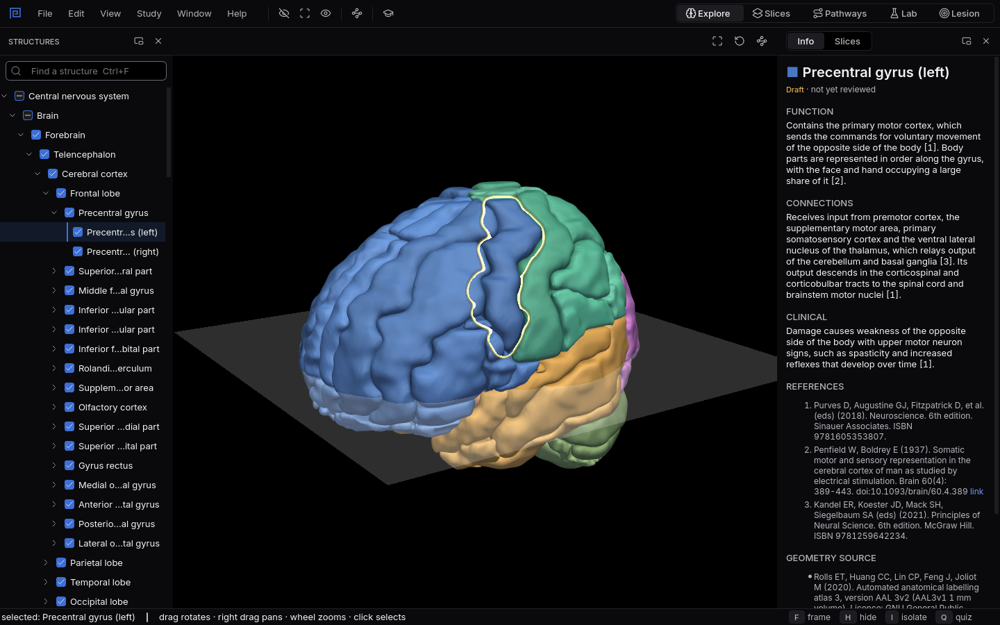
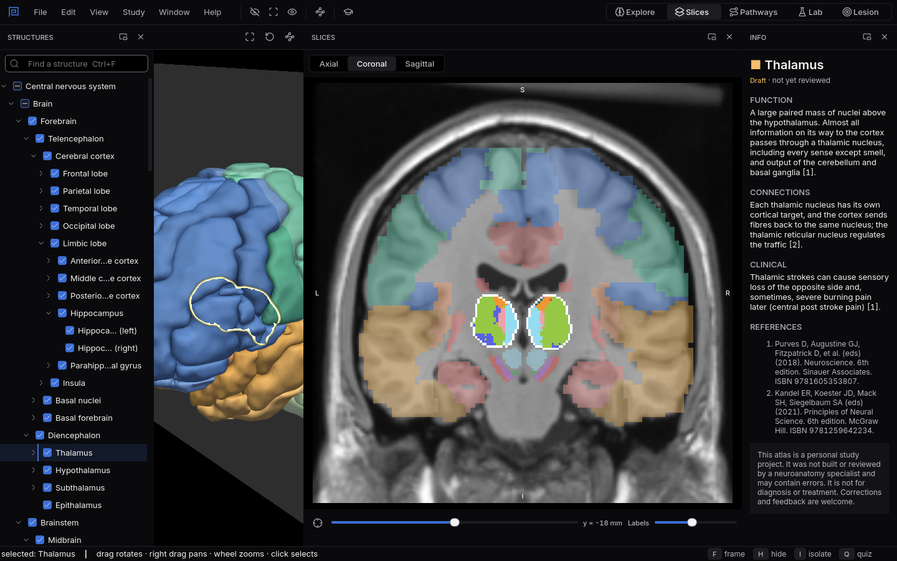
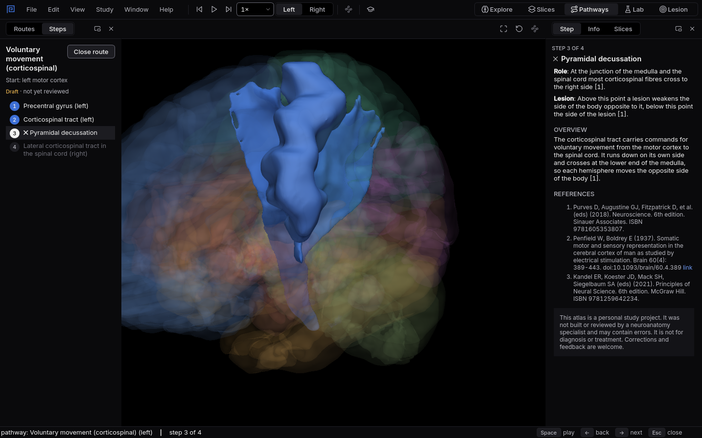
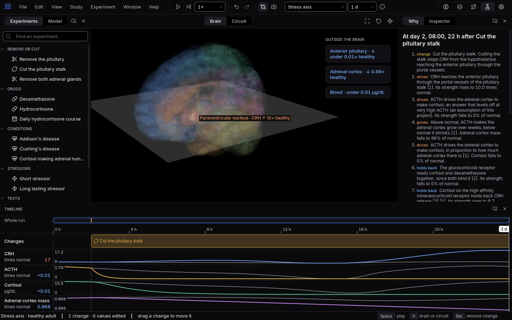
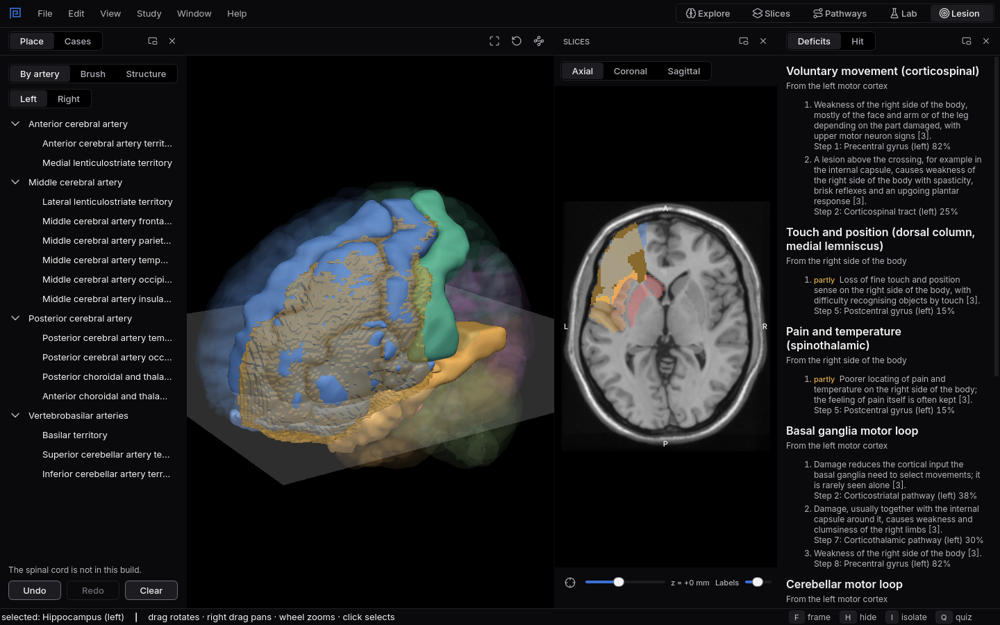
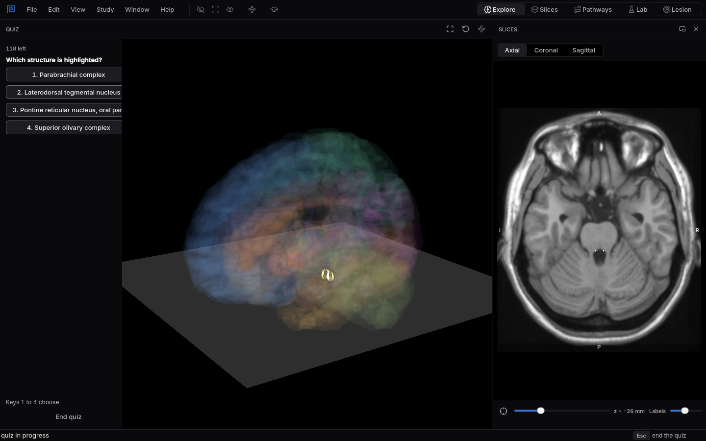

# Start here

Mnemosyn is a free 3D atlas of the human brain and spinal cord, with a lab where you change the
body and watch it answer. It runs on Windows and Linux without an internet connection, and every
shape, number and sentence in it names its source.
{ .lede }

[Download Mnemosyn](../download.md){ .md-button .md-button--primary }
[Why use it](why.md){ .md-button }

This handbook explains each part of the app in the same three steps: how to use it, why it is
worth using here rather than in a book or another app, and what you will see when you try it.
Ten minutes with the tour below is enough to find your way around.

## Your first ten minutes

When Mnemosyn opens you see the brain in 3D, the list of structures on the left and the Info panel
on the right. The switch at the top right of the window moves between five workspaces. Each one is
a different way into the same anatomy, so a structure you learn in one is the same structure in all
the others.

### Explore: the brain in 3D

{ .shot }

Click any part to select it and read what it does, what it connects to and what damage there
causes, with numbered references. Drag to turn the brain, scroll to zoom, press `F` to frame what
you selected and `I` to see it alone. Try clicking the strip of cortex just in front of the
central sulcus: that is the precentral gyrus, where voluntary movement starts.
[More about Explore](explore.md)

### Slices: the brain as an atlas plate

{ .shot }

The same labels drawn on an MRI, in axial, coronal or sagittal sections, the way exams and scans
show the brain. Move the slider and watch the plane travel through the 3D brain at the same time.
[More about Slices](slices.md)

### Pathways: follow a route step by step

{ .shot }

Pick a route, such as voluntary movement or pain and temperature, and walk it station by station.
Each step says what happens there and what a lesion there would do.
[More about Pathways](pathways.md)

### Lab: change the body and watch it answer

{ .shot }

The Lab runs a model of the stress axis or of water balance. Remove a gland, give a drug or run a
clinical test, and every hormone moves on a timeline beside its normal day. The Why panel explains
each change as a chain of causes.
[More about the Lab](lab.md)

### Lesion: from a lesion to the signs

{ .shot }

Place a lesion with a brush, a whole structure or an arterial territory, and see which structures
it hits, which routes it breaks and the signs that follow. Cases turn it around: you read the
signs and find the lesion.
[More about Lesion](lesion.md)

### Quizzes: keep what you learned

{ .shot }

Press `Q` to start a quiz built from the atlas itself. Mnemosyn schedules each structure for review
just before you would forget it.
[More about quizzes](quizzes.md)

## Arranging the window

Each workspace arranges its panels for its task, and you can change that. Drag a panel by its
header to move it or to float it as a window of its own; the buttons beside the header float or
close it. Panels that share a place, such as Info and Slices, switch with the control in their
header. Each workspace remembers its own arrangement. If you close a panel, the **Window** menu
brings it back, and **Window, Reset layout** restores the arrangement the workspace started with.
In a narrow window the default arrangements fold the right hand panels into the left one and the
menus into one menu button; an arrangement you made yourself is never changed.

## Where next

1. Try an experiment: [Central or nephrogenic?](experiments/central-or-nephrogenic.md) takes five
   minutes and shows why the Lab is more than a diagram.
2. Read [Why Mnemosyn](why.md) for what it does better than other study tools, and where it does
   not.
3. Read [Sources and review](trust.md) before you rely on anything for an exam.
