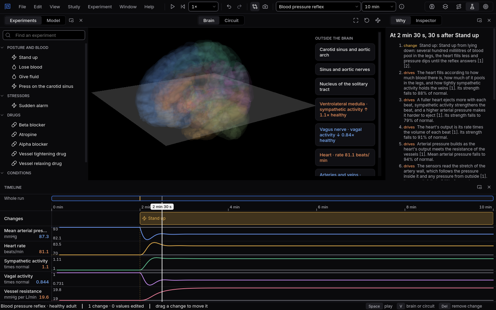

# The blood pressure reflex

Stand up, lose blood, give a drug or cut a nerve, and watch pressure, heart rate and the two sets
of autonomic nerves answer second by second.
{ .lede }

How
Pick **Blood pressure reflex** on the top bar, then drag a change from **Experiments** onto the
Timeline.

Why here
The reflex is over in seconds, too fast to follow in a figure. Here you can stop it at any moment
and ask why.

What you will see
Lanes for mean arterial pressure, heart rate, sympathetic and vagal activity and vessel resistance,
on a timeline in minutes and seconds.

{ .shot }

Half a minute after standing up: pressure has dipped and come most of the way back, the heart is faster, sympathetic activity is up and vagal activity is down.

## How to use it

Pick **Blood pressure reflex** in the system picker. This system runs in minutes, not days: a run
is 10 minutes long unless you change it, the ruler reads minutes and seconds, and you can zoom in
to a few seconds. The lanes show mean arterial pressure, heart rate, sympathetic activity, vagal
activity and vessel resistance. The changes you can add are:

1. **Posture and blood:** stand up, lose blood, give fluid, or press on the carotid sinus for some
   seconds.
2. **Stressors:** a sudden alarm.
3. **Drugs:** a beta blocker, atropine, an alpha blocker, and drugs that tighten or relax the
   vessels directly.
4. **Conditions:** the sensor nerves cut, and autonomic failure, in which the nerves keep their
   resting activity but can hardly change it.

Stretch sensors in the carotid sinus and the aortic arch report pressure to the nucleus of the
solitary tract in the medulla. From there the vagus slows the heart, and the sympathetic neurons of
the ventrolateral medulla are held back. A fall in pressure does the opposite within seconds. The
medullary nuclei come from a source that has not yet allowed sharing, so in the public download
they appear as cards beside the brain.

## Why use it here

Students learn the baroreflex as a rule: pressure down, heart rate up. The exam questions are about
the exceptions and the order of events. Why does a drug that raises pressure slow the heart? Why
does a patient with autonomic failure faint on standing with no rise in heart rate? Why does
blocking the vagus raise the rate more than blocking the sympathetic nerves lowers it? Each of
these is one drag onto the timeline here, and the Why panel names the step that explains it.

## What you will see

1. **Stand up** at two minutes: pressure dips for some seconds, then the heart speeds up, the
   vessels tighten and pressure returns close to where it was.
2. Add **autonomic failure** and stand up again: pressure falls and stays down, and the heart rate
   hardly moves. That pair of findings is neurogenic orthostatic hypotension.
3. Give the **vessel tightening drug**: pressure rises and the heart slows. Then give **atropine**
   as well: the slowing is gone, because it came through the vagus.
4. Give a **beta blocker** and **atropine** together: the heart settles near 100 beats a minute,
   the pacemaker's own rate without its nerves.
5. **Lose** half a litre of blood, then a litre and a half: the heart rate tells you about the loss
   before the pressure does.

The quiz level **Lab: what happens** asks about all of these.

## What the model leaves out

It covers the first seconds to minutes only. It leaves out the kidneys, renin, angiotensin,
aldosterone and vasopressin, which set pressure over hours to days (see
[blood pressure over days](lab-volume.md)); the slow resetting of the
sensors to a new pressure; breathing; the low pressure sensors of the heart and lungs; and the
difference between systolic and diastolic pressure. With the sensor nerves cut, real pressure
becomes very variable while its average drifts back towards normal over days; the model shows only
the sharp rise of the first minutes. Its strengths and speeds are set to give textbook sized
responses, not fitted to one person. **What this model includes** in the app gives the full list.
It is a study model, not a tool for diagnosis or treatment.
