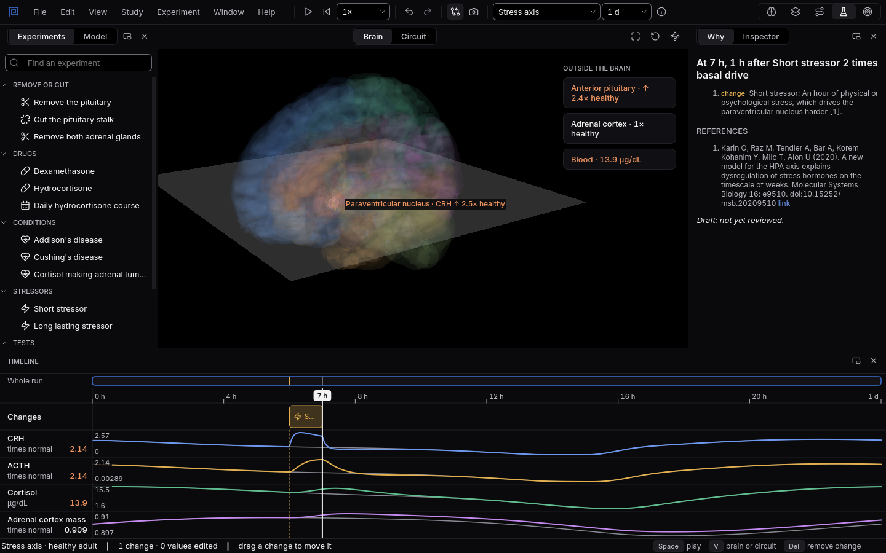

# The stress axis

Remove a gland, give a steroid, add a stressor or a disease, and watch CRH, ACTH and cortisol
answer minute by minute, and the glands grow or shrink over weeks.
{ .lede }

How
Pick **Stress axis** on the top bar, then drag a change from **Experiments** onto the Timeline.

Why here
The feedback loop runs for real, including the slow growth and shrinking of the glands that
diagrams leave out.

What you will see
The paraventricular nucleus and pituitary coloured by change, and lanes for CRH, ACTH, cortisol
and adrenal mass.

{ .shot }

An hour of stress at two times the normal drive: CRH jumps, ACTH follows, cortisol rises, then all three settle back.

## How to use it

Pick **Stress axis** in the system picker. The lanes show CRH (as a multiple of normal, since it has
never been measured in people), ACTH, cortisol and the mass of the adrenal cortex. The changes you
can add are:

1. **Remove or cut:** remove the pituitary, cut the pituitary stalk, or remove both adrenal glands.
2. **Drugs:** dexamethasone, hydrocortisone once, or a daily hydrocortisone course over weeks.
3. **Conditions:** Addison's disease, Cushing's disease, and a cortisol making adrenal tumour.
4. **Stressors:** a short stressor of an hour, or a long one over weeks.
5. **Tests:** the overnight 1 mg and 8 mg dexamethasone tests, and the ACTH stimulation test. The
   Inspector reads the result as a clinic would and says whether it is normal.

## Why use it here

The stress axis is a loop with two speeds. Hormones change in minutes, but the corticotroph cells
and the adrenal cortex grow or shrink over days and weeks, and that slow part explains much of what
happens in clinic: why a long steroid course must be stopped slowly, why an adrenal tumour shuts
the other gland down. Diagrams show the fast arrows and leave out the slow ones. This model, after
Karin and colleagues (2020), has both, and every number in it cites its source.

## What you will see

1. Add **Addison's disease**: cortisol falls and ACTH climbs to many times normal, because nothing
   holds it back. [Try it as an experiment](experiments/addisons-disease.md).
2. Add **Cushing's disease** and both dexamethasone tests: the low dose fails to suppress cortisol,
   the high dose succeeds. [Try it as an experiment](experiments/dexamethasone-tests.md).
3. Add a **daily hydrocortisone course** and run eight weeks: the adrenal cortex shrinks while the
   course runs, and cortisol is low for days after it stops.
   [Try it as an experiment](experiments/stopping-a-steroid-course.md).

## What the model leaves out

It leaves out the hourly pulses of cortisol, CRH and ACTH from outside the axis, vasopressin,
binding proteins, the kidneys and the liver, and drugs whose behaviour could not yet be tied to
checked sources. **What this model includes** in the app gives the full list. It is a study model,
not a tool for diagnosis or treatment.
