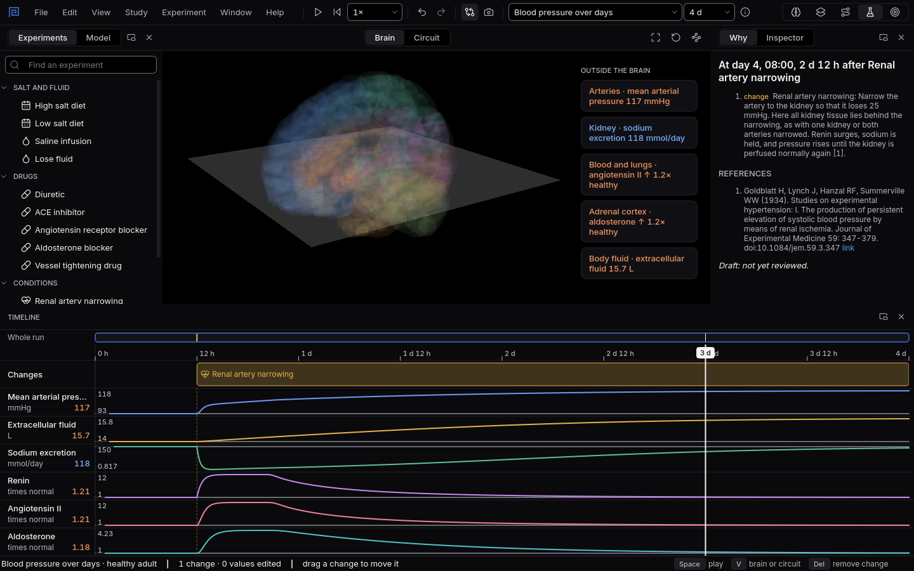

# Blood pressure over days

Change the salt in the diet, give a drug, narrow a renal artery, and watch the kidney, renin,
angiotensin and aldosterone settle the pressure over days.
{ .lede }

How
Pick **Blood pressure over days** on the top bar, then drag a change from **Experiments** onto the
Timeline.

Why here
The long run answer is often the opposite of the first hour. Here both are on one timeline, and
you can ask why at either end.

What you will see
Lanes for mean arterial pressure, extracellular fluid, sodium excretion, renin, angiotensin II and
aldosterone, on a timeline in hours and days.

{ .shot }

Two and a half days after a renal artery was narrowed: renin surged and is coming back down, fluid has been held, and pressure has risen until the kidney is perfused normally again.

## How to use it

Pick **Blood pressure over days** in the system picker. A run is days long, like the stress axis
and water balance. The lanes show mean arterial pressure, the volume of extracellular fluid, the
sodium the kidneys excrete each day, renin, angiotensin II and aldosterone. The changes you can add
are:

1. **Salt and fluid:** a high salt diet, a low salt diet, a saline infusion, or a loss of fluid.
2. **Drugs:** a diuretic, an ACE inhibitor, an angiotensin receptor blocker, an aldosterone
   blocker, and a drug that tightens the vessels directly.
3. **Conditions:** renal artery narrowing, primary aldosteronism, and reduced kidney mass.

The idea behind the model is one balance. A person is steady only when the kidneys excrete the
sodium that is eaten. A higher pressure at the kidney makes it excrete more, so if sodium is held
back, fluid and pressure rise until excretion matches intake again. Renin, angiotensin II and
aldosterone move that balance point: they let a healthy person eat very little or very much salt
with almost the same pressure.

This system has no brain structures of its own. It is here because it completes
[the blood pressure reflex](lab-pressure.md): the medulla answers in seconds, the kidney decides
over days.

## Why use it here

The exam questions on this topic are about what happens later. Why does a drug that only tightens
the vessels not cause lasting high pressure? Why is renin high in the first days after a renal
artery narrows and normal later, while the pressure stays up? Why does sodium excretion return to
normal in primary aldosteronism although aldosterone stays high? Why do an ACE inhibitor and a
receptor blocker both raise renin, but only one raises angiotensin II? Each is one drag onto the
timeline, and the Why panel names the step that explains it.

## What you will see

1. Start a **high salt diet**: excretion climbs to match the new intake within a day or two, renin
   and aldosterone fall, and pressure rises only a few mmHg.
2. Add **primary aldosteronism** first and repeat: now the hormones cannot fall, and the same salt
   raises pressure far more. That is salt sensitivity.
3. Give the **vessel tightening drug**: pressure jumps, the kidney excretes more, fluid is lost and
   pressure is back to normal within days.
4. Narrow the **renal artery**: renin surges within hours, then falls back as pressure rises. Add an
   **ACE inhibitor** and the pressure comes part of the way down.
5. Give an **ACE inhibitor** in one run and a **receptor blocker** in another: pressure, renin and
   aldosterone match, and only angiotensin II differs.
6. Give a **diuretic**: sodium is lost for a day or two only. After that the kidney excretes what
   is eaten again, at a lower fluid volume and with more renin.

The quiz level **Lab: what happens** asks about all of these.

## What the model leaves out

Sodium and water move together here, so the sodium concentration never changes; for that, use
[water balance](lab-water.md). The fast nerve reflex is left out, as are potassium, natriuretic
peptides, the sympathetic nerves to the kidney and the slow changes in vessels and heart that long
standing high pressure brings. A narrowed renal artery is modelled with all kidney tissue behind
the narrowing; with one healthy kidney on the other side, renin stays high for longer. The strengths
of the hormone effects are set to give textbook sized responses, not fitted to one person, and each
is marked as an assumption in its text. **What this model includes** in the app gives the full
list. It is a study model, not a tool for diagnosis or treatment.
