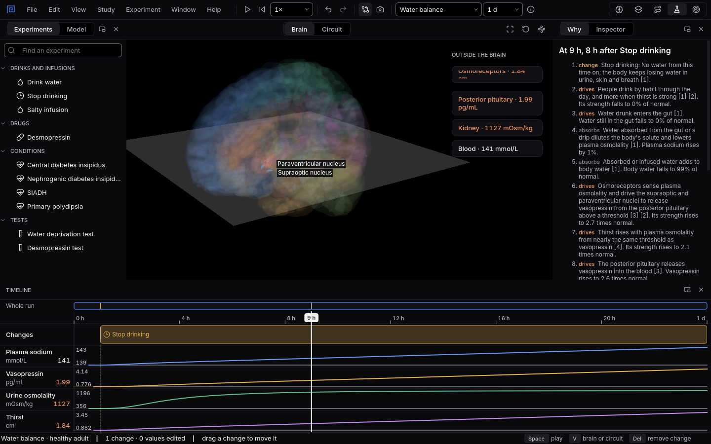

# Water balance

Change how much the body drinks, what the kidneys can do or how much vasopressin the pituitary
releases, and watch sodium, vasopressin, urine and thirst answer hour by hour.
{ .lede }

How
Pick **Water balance** on the top bar, then drag a change from **Experiments** onto the Timeline.

Why here
A textbook shows the loop as arrows. Here it runs, so you see how fast and how far each part moves.

What you will see
The supraoptic and paraventricular nuclei coloured by change, and lanes for sodium, vasopressin,
urine and thirst.

{ .shot }

Eight hours without water: plasma sodium creeps up, vasopressin rises, and the urine concentrates.

## How to use it

Pick **Water balance** in the system picker. The lanes show plasma sodium, vasopressin, urine
osmolality and thirst. The changes you can add are:

1. **Drinks and infusions:** drink water, stop drinking, or a salty infusion.
2. **Drugs:** desmopressin, the synthetic form of vasopressin.
3. **Conditions:** central and nephrogenic diabetes insipidus, SIADH and primary polydipsia.
4. **Tests:** the water deprivation test (eight hours without water, then the urine is read) and
   the desmopressin test, which adds desmopressin after the deprivation and reads how much the
   urine rises.

## Why use it here

Water balance is a loop that students learn as a sentence: high osmolality, more vasopressin,
concentrated urine, more thirst. The questions that matter are about numbers and time, and they are
what tell the diseases apart: how concentrated the urine gets after a night without water, and
whether desmopressin changes it. Here you run the tests yourself on each disease and read the same
numbers a clinic would, after the classic measurements of Robertson and colleagues.

## What you will see

1. Run the **water deprivation test** on a healthy body: the urine concentrates strongly. Add
   **central diabetes insipidus** and it stays dilute.
   [Try it as an experiment](experiments/a-night-without-water.md).
2. Run the **desmopressin test** on central and on nephrogenic diabetes insipidus: the urine rises
   by more than half in one and hardly moves in the other.
   [Try it as an experiment](experiments/central-or-nephrogenic.md).
3. Compare **SIADH** with **primary polydipsia**: both mean too much water, but only SIADH drags
   sodium down, and the urine shows why. [Try it as an experiment](experiments/too-much-water.md).

## What the model leaves out

It leaves out blood volume and blood pressure reflexes, aldosterone, the washout of the kidney's
concentrating gradient, the kidney's escape from vasopressin that stops sodium falling after a few
days of SIADH, sleep, and the stress axis. **What this model includes** in the app gives the full
list. It is a study model, not a tool for diagnosis or treatment.
