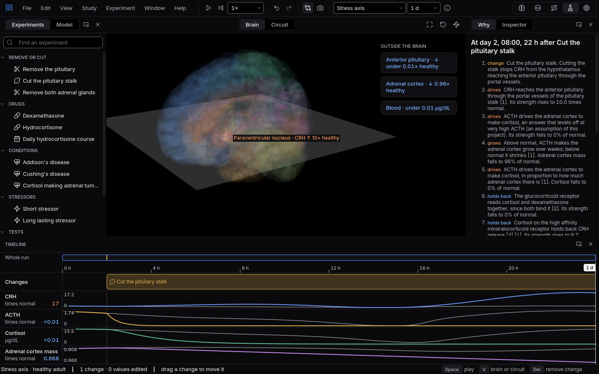

# Lab

Run a model of a hormone system, change it, and watch every part answer over minutes to weeks,
with each step explained and every number sourced.
{ .lede }

How
Choose a system on the top bar, drag a change onto the **Timeline**, and move the playhead.

Why here
A feedback loop in a book is a ring of arrows. Here it runs, so you see how fast and how far each
part moves.

What you will see
The brain coloured by change, a lane for every value beside its normal day, and a Why chain of
causes.

{ .shot }

The stress axis after cutting the pituitary stalk: CRH piles up, ACTH and cortisol fall, and the Why panel explains each step.

Two systems are in the Lab today, each with its own page:

1. **[The stress axis](lab-stress.md):** the hypothalamus, pituitary and adrenal cortex, and
   cortisol.
2. **[Water balance](lab-water.md):** plasma sodium, vasopressin, the kidney and thirst.

## How to use it

**Choose a system** in the picker on the top bar. Each system runs on its own, and a saved
experiment opens in the system it was made in.

**Add changes.** The **Experiments** list holds what you can do to the body: remove or cut a gland,
give a drug, switch on a disease, add a stressor, or run a clinical test. Drag one onto the
**Timeline**, or double click it to add it at the playhead. Drag a change to move it and drag its
right edge to make it last longer. Select it to set its dose, time or strength in the
**Inspector**. Diseases are present from the start of a run unless you give them a start time.

**Read the timeline.** Each lane is one value, with the untouched normal run in grey behind it. The
lane names its value and unit and gives its level at the playhead, coloured when it is above or
below normal. A dashed line drops from every change so you can see where each curve reacts. Move
the playhead with the mouse or the arrow keys (`Shift` for bigger steps), and point at a lane to
read every value at that moment. The strip at the top shows the whole run: drag its window to move
and its edges to zoom.

**Look at the body.** The centre shows the brain with the parts of the model coloured by how far
they are from normal and labelled with their level. Parts outside the brain, such as the adrenal
cortex and the blood, sit as cards beside it. `V` switches to the model as a live circuit whose
arrows thicken and thin with each signal.

**Ask why.** The **Why** panel explains the difference from normal at the playhead as a numbered
chain of causes, each marked with what it does (drives, holds back, grows) and with its sources.
With no changes it explains the normal day.

**Go deeper.** **Model** shows every value of the model for experts, with its normal value, range
and source; edited values are marked in gold. **What this model includes** says what the model
covers and what it leaves out. **Take snapshot** keeps a copy of the current run to compare against.

**Save and share.** **File, Save** writes the experiment as a small `.mnemolab` file that you can
open again or send to someone. It holds only the experiment, not the model. The experiments in this
handbook are files like that.

## Why use it here

Hormone systems are taught as loops of arrows, and the questions that matter are about time and
size: how long does cortisol stay low after the stalk is cut, why does ACTH climb so high in
Addison's disease, how fast does urine concentrate without water. A diagram cannot answer those;
most physiology lab software does not cover hormone loops at all. Here you set the change yourself,
see the answer on a clock, and read why, with the source of every number one click away.

## What you will see

1. With no changes at all, press `Space`: cortisol rises before waking and falls through the day,
   and the Why panel explains the normal rhythm.
2. Add **Cut the pituitary stalk**, then switch to the circuit with `V`: the arrow from the
   hypothalamus to the pituitary goes quiet while CRH piles up behind it.
3. Open an experiment from this handbook, such as
   [Central or nephrogenic?](experiments/central-or-nephrogenic.md), and read the test result in the
   Inspector.

## Shortcuts

| Key | Action |
|---|---|
| `Space` | Play or pause the run |
| `Home` | Back to the start of the run |
| `V` | Switch the centre between the brain and the circuit |
| `Del` | Remove the selected change |
| `Ctrl+Z` / `Ctrl+Shift+Z` | Undo or redo |
| `Ctrl+N` / `Ctrl+O` | New or open an experiment |
| `Ctrl+S` / `Ctrl+Shift+S` | Save or save as |
| `Ctrl+4` | Switch to the Lab workspace |
