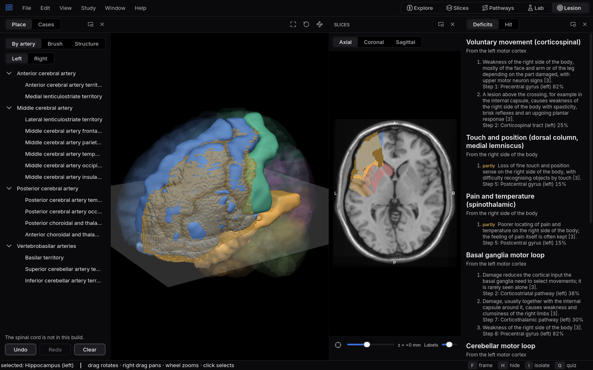

# Lesion

Place a lesion and see what it destroys and the signs it causes, or read a patient's signs and find
the lesion.
{ .lede }

How
In **Place**, pick an arterial territory, paint with the brush, or click a whole structure.

Why here
Localisation is the step from anatomy to the clinic, and it is rarely something you can practise
on screen.

What you will see
The lesion in gold, the structures it hits, and every route it breaks, turned into the deficits
that follow.

{ .shot }

The left middle cerebral artery frontal territory: the lesion takes the precentral gyrus and the inferior frontal gyrus, and Deficits lists weakness of the right side of the body first.

## How to use it

**Place a lesion** in the **Place** tab, in one of three ways:

1. **By artery:** pick an arterial territory, after the atlas of Liu and colleagues (2023), and a
   side. This is how strokes are shaped.
2. **Brush:** click or drag on the slice to paint spheres with a radius you choose, from 2 to 20 mm.
   Hold `Ctrl` to erase.
3. **Structure:** click a structure in the slice or in 3D to make all of it the lesion.

The lesion is drawn in gold on the slice and in 3D. **Undo**, **Redo** and **Clear** work as you
expect.

**Read the result.** **Deficits** lists the routes the lesion breaks, from the side each route
begins on, with the deficit at every broken step, the structures behind it, a **partly** mark when
only a small share of a station is hit, and the sources; then the routes it spares. **Hit** ranks
every structure the lesion touches by how much of it is inside.

**Solve cases.** **Cases** turns it around. **New case** describes a patient's signs; you place the
lesion you think explains them, and **Check** marks each sign as matched, missed or extra and shows
the real lesion in blue. Cases come from the same engine, so a case never contradicts its own
lesion.

## Why use it here

Localisation is where neuroanatomy pays off: knowing that a weak right arm and a broken sentence
point to the left frontal lobe. Books teach it with tables of syndromes, and you take them on
trust. Here you make the lesion yourself, watch which structures fall inside it, and see each sign
come from a route it breaks, using the same cited texts as the Pathways workspace. Cases let you
practise the real direction, from signs to place, as often as you like.

## What you will see

1. Choose the left **Middle cerebral artery frontal territory**: it takes the precentral gyrus and
   Broca's area together, which is why weakness of the right side and trouble speaking so often
   come together. [Try it as an experiment](experiments/one-artery-many-structures.md).
2. Paint one small sphere, 3 mm in radius, on the ventral posterolateral nucleus of the thalamus: it
   breaks both the touch route and the pain route, because both relay there on their way to the
   cortex.
3. Start a **New case**, read the signs, and place your lesion before you press **Check**.

## Limits

The public download has no spinal cord yet, because its authors have not allowed sharing, so cord
lesions work only in local builds; the Place tab says so. Syndromes of the medulla need cranial
nerve nuclei the atlas does not have and are not modelled. Lesion mode is for studying, not for
diagnosis or treatment.

## Shortcuts

| Key | Action |
|---|---|
| `Ctrl` while painting | Erase |
| `Ctrl+Z` / `Ctrl+Shift+Z` | Undo or redo the lesion |
| `Ctrl+5` | Switch to the Lesion workspace |
