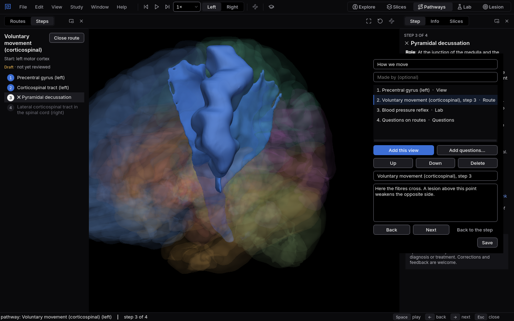

# Lessons

A lesson is one small file that walks a class through the app: a few views, a route, an experiment
and some questions, each with a note from the teacher.
{ .lede }

How
**File, New lesson**, arrange the app, press **Add this view**, write a note, and save.

Why here
A slide shows one picture. A lesson step puts the student inside the same view, free to turn it.

What you will see
A small Lesson window with the steps, the note for the current step, and Back and Next.

{ .shot }

Making a lesson: step 2 opens the voluntary movement route at the pyramidal decussation, with the teacher's note under the list.

## Making a lesson

Choose **File, New lesson**. A Lesson window opens beside the app and stays there while you work.

1. **Add a step.** Put the app in the state you want the class to see, then press
   **Add this view**. What is saved depends on where you are:
   in Explore or Slices, the selection, what is hidden, the camera and the slice;
   with a route open in Pathways, the route, its side and the station;
   in the Lab, the system, its changes, any edited values and the playhead.
2. **Add questions.** **Add questions** opens the same choices as **Study, Start quiz**. The step
   becomes a practice round on that level and scope, for example routes in one group or the Lab
   questions on one system.
3. **Write the note.** Give the step a title and, if you like, a note of a few sentences.
4. **Order the steps** with **Up** and **Down**, remove one with **Delete**, and click any step to
   see it again.
5. **Save.** The lesson is a `.mnemolesson` file you can send to the class like any other file.

A lesson cannot hold a Lesion view or flashcards yet.

## Using a lesson

Double click the file, or choose **File, Open lesson**. The Lesson window lists the steps.
**Next** and **Back** move through them, and each step arranges the app and shows its note. You
stay free to turn the brain, move the playhead or try something else; **Back to the step** puts
the step back as the teacher saved it. A question step runs as practice, so it never changes your
own quiz schedule. **Edit** turns the lesson into one you can change and save.

## What a lesson contains

A lesson holds only the teacher's titles and notes and pointers to things in the app: structure
numbers, a route's name, an experiment. It copies no descriptions, so the texts a student reads are
always the app's own, with their review status. If a lesson was made on a fuller atlas than yours,
a step says what is missing and shows the rest. Mnemosyn sends nothing: sharing the file is up to
you, and you should open lessons only from people you trust to write sensible notes, since the
notes are theirs and not reviewed by anyone.
