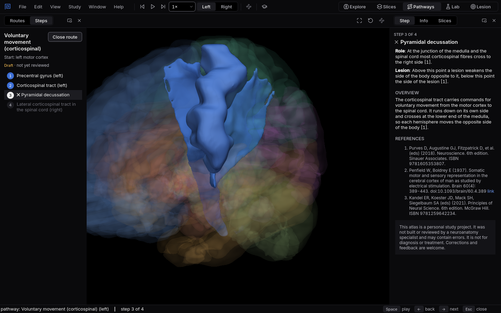
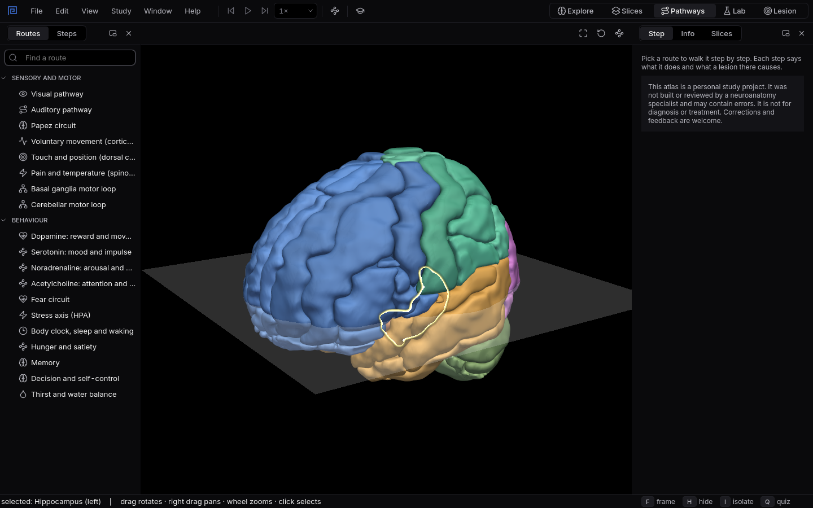

# Pathways

Walk a route through the nervous system one station at a time, and learn what each step does and
what breaks when it is damaged.
{ .lede }

How
Pick a route in **Routes**, choose a side, then step with the arrow keys or press `Space` to play.

Why here
A pathway diagram is flat. Here the route is drawn in the real brain, and the slice follows each
step.

What you will see
The whole route in 3D, passed steps coloured, the current step lit, and its role and lesion
effect in words.

{ .shot }

Voluntary movement from the left motor cortex, at step 3: the pyramidal decussation, where most fibres cross to the other side.

## How to use it

**Choose a route.** The **Routes** tab lists the routes in two groups. Sensory and motor: the
visual and auditory pathways, the Papez circuit, voluntary movement, touch and position, pain and
temperature, and the basal ganglia and cerebellar motor loops. Behaviour: the dopamine, serotonin,
noradrenaline and acetylcholine systems, the fear circuit, the stress axis, the body clock, hunger,
memory, decision and self control, and thirst and water balance.

**Walk it.** Opening a route draws all of it in 3D and frames it. The **Steps** tab lists every
station; `Left` and `Right` move back and forward, and `Space` plays the route on its own at the
speed you choose. Crossings and relays that have no shape in the atlas are steps of their own.

**Read each step.** The **Step** tab on the right says what happens at the current station and
what a lesion there would do, with references. For sensory and motor routes, **Left** and
**Right** choose the side the route starts on. Behaviour routes light both sides and list the
disorders and drugs linked to each step.

**Timelines.** The stress axis, body clock and hunger routes add Lab style lanes that show a
hormone over the day, with a cursor that follows the steps. Thirst and water balance, and the
stress axis, also offer a button that opens the same system in the Lab.

**Close the route** with `Esc` or **Close route**, and the view comes back as it was.

{ .shot }

The Routes tab: sensory and motor routes first, then the behaviour systems.

## Why use it here

Pathways are where neuroanatomy turns into neurology: a lesion matters because of the route it
cuts. Diagrams show the route as boxes and arrows, which hides where it actually runs and why a
small lesion in one place causes so much. Here you see the route in the real brain, step through
it with the slice following, and read the deficit at every station. The same texts drive the
Lesion workspace, so what you learn on a route is exactly what a lesion there will report.

## What you will see

1. Open **Voluntary movement** from the left side and step to the pyramidal decussation: the route
   crosses, so everything after it is on the right. That is why a stroke in the left hemisphere
   weakens the right side of the body. [Try it as an experiment](experiments/which-side.md).
2. Open **Pain and temperature** and compare where it crosses with voluntary movement: much lower,
   in the spinal cord, right where the fibres enter.
3. Open the **Stress axis** and press `Space`: the lanes show cortisol rising in the early morning
   and falling through the day as the steps light up.

## Shortcuts

| Key | Action |
|---|---|
| `Left` | Previous step |
| `Right` | Next step |
| `Space` | Play or pause the route |
| `Esc` | Close the route |
| `Ctrl+3` | Switch to the Pathways workspace |
