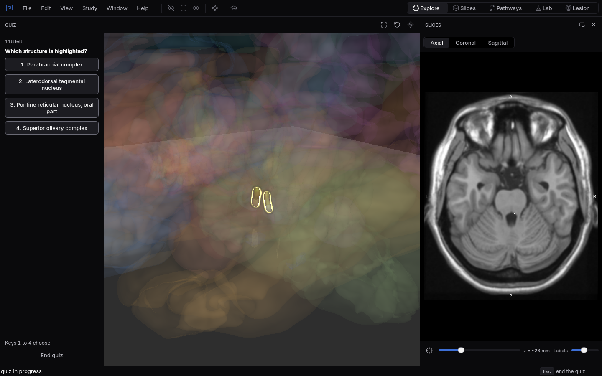
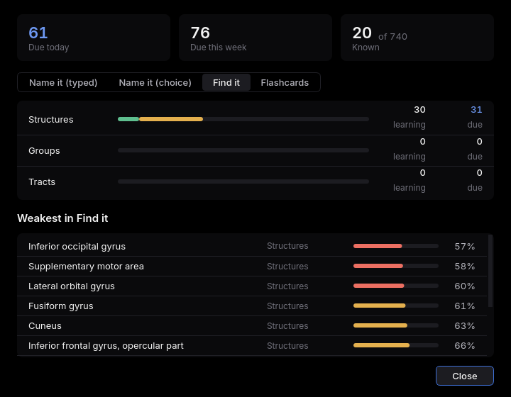

# Quizzes

Questions built from the atlas itself, scheduled so you review each structure just before you would
forget it.
{ .lede }

How
Press `Q`, choose a mode, a level and how much of the atlas, then answer.

Why here
No cards to write: every question shows the real structure in 3D or in a slice.

What you will see
A highlighted structure to name, or a name to find, and a Progress window that shows what is due.

{ .shot }

Name it, with four choices: the highlighted structure glows while the rest of the brain fades.

## How to use it

**Start a quiz** with `Q` or **Study, Start quiz**. Choose:

1. **A mode.** *Name it* highlights a structure on both sides, brings the 3D view in close enough
   to see it with the brain around it, and asks for its name: type it, or pick one of four with the
   keys `1` to `4`. Typed answers accept synonyms, abbreviations, any word
   order and small typos. *Find it* names a structure and you click it in 3D or in a slice.
   *Flashcards* show a structure's name, then its description when you ask for it, and you rate
   how well you knew it. They use reviewed descriptions only. None are reviewed yet, so this mode
   stays empty for now and fills in as descriptions are reviewed.
2. **A level.** Single structures, bigger groups, or the white matter tracts.
3. **How much.** The whole atlas or one part of it, such as the brainstem.
4. **Due or practice.** A due round asks what the schedule says you need today. A practice round
   leaves your schedule alone.

During a quiz the structure list, the Info panel and hover names are hidden, so you cannot peek.
`Esc` ends the quiz and gives the window back.

**Answering.** After a typed or chosen answer, `Enter` goes on to the next question. If you were
right, `H` marks it as hard and `E` as easy, which moves its next review closer or further away.
In *Flashcards*, `Space` shows the description and `1` to `4` rate how well you knew it, from
again to easy.

**Scheduling** uses FSRS, the spaced repetition method many flashcard apps use, with at most 20 new
items a day in each mode. A right answer is done until its next review; a miss comes back a minute
or so later in the same round. The round ends with your score on first tries and the items you
missed most. Your answers are saved after every question, on your own computer, in a
file called `progress.sqlite` in your user data folder (on Linux,
`~/.local/share/mnemosyn/progress.sqlite`).

**Progress** (**Study, Progress**) shows what is due today and this week and how many items you
know, then each mode by level: a bar of known, learning and new items, and your weakest items with
how likely you are to recall each one.

{ .shot }

Progress for Find it: structures being learned, how many are due, and the weakest items with their chance of recall.

## Why use it here

Spaced repetition is one of the most reliable ways to remember facts, but most flashcards for
neuroanatomy are text or a single picture, and someone has to make them. Here the questions come
from the atlas, so there are always enough of them, and every question shows the structure in
place. *Find it* trains the skill exams test most: pointing at the right spot in a section or a 3D
view, not just reciting a name.

## What you will see

1. Run a *Find it* round on the basal nuclei and notice which ones you mix up; they are usually
   neighbours.
2. After a few days, open **Progress**: items you got right sit further out in the schedule, and
   the weakest list shows exactly what to review next.
3. Try the **Tracts** level: while a tract is asked, the grey matter around it dims so the tract
   stands out.

## Shortcuts

| Key | Action |
|---|---|
| `Q` | Start a quiz |
| `1` to `4` | Choose an answer in Name it with choices, or rate a flashcard |
| `Enter` | Submit a typed answer, or go on to the next question |
| `H` / `E` | After a right answer: mark it hard or easy |
| `Space` | Show a flashcard's description |
| `Esc` | End the quiz |
