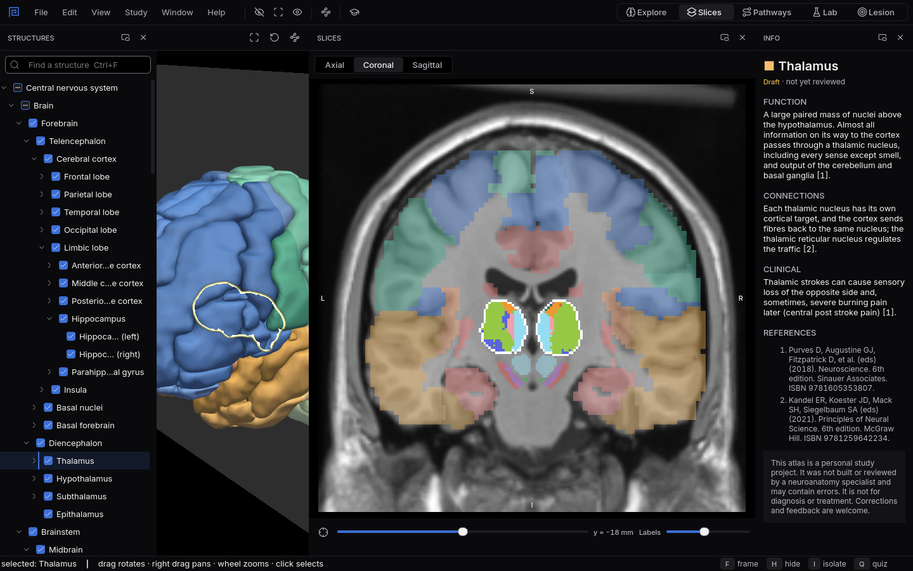

# Slices

The brain cut into sections, like the plates of a printed atlas, with every label still clickable.
{ .lede }

How
Pick Axial, Coronal or Sagittal, move the slider, and hover or click a label.

Why here
Exams and scans show the brain in sections. Here each section is tied to the 3D brain beside it.

What you will see
Coloured labels over an MRI, and the plane of the slice moving through the 3D brain as you go.

{ .shot }

A coronal slice through the thalamus, with the plane of the slice shown in the 3D view on the left.

## How to use it

**Choose a plane.** Axial, Coronal and Sagittal sit above the slice. The slice shows coloured
labels over an MRI template, in neurological convention: the patient's left is on the left of the
screen, with L, R, A, P, S and I marked on the edges.

**Move through it.** The slider under the slice moves the plane, which also appears as a sheet in
the 3D view. The second slider sets how strongly the labels are drawn, so you can fade them and
read the MRI underneath.

**Read and select.** Hover a label to see its name; click it to select it, which selects it in
every other workspace too. `C` moves the plane through the selected structure.

**Zoom.** The wheel zooms around the pointer, a right drag pans, and `F` with the pointer over the
slice fits the whole section again.

The Slices panel also sits beside the 3D view in Explore, Pathways and Lesion, so you can keep a
section open while you work in 3D.

## Why use it here

Clinical images and exam questions show the brain as sections, and the hard part is knowing which
3D structure a patch of grey belongs to. In a printed atlas you turn to the next plate and hope you
are still looking at the same thing. Here the plane moves through the 3D brain as you slide it, and
every label is the same structure you can turn around in Explore. You learn to read a section by
seeing where it comes from.

## What you will see

1. Select the **Thalamus**, press `C`, then switch between the three planes: the same structure,
   three very different outlines.
2. Fade the labels to almost nothing with the second slider and try to name what you see on the
   MRI alone, then bring the labels back to check.
3. In a coronal section, slide from front to back through the **Caudate nucleus**: its head is
   large at the front and its tail thins out along the ventricle.

## Shortcuts

| Key | Action |
|---|---|
| `C` | Centre the slice on the selection |
| `F` | Over the slice: fit the whole section |
| `Ctrl+2` | Switch to the Slices workspace |
